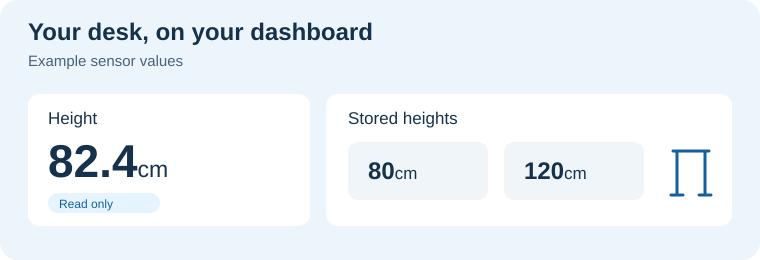

# LINAK for Home Assistant

**Your desk height in centimeters, right in Home Assistant.** A native Bluetooth integration for LINAK **DPG1C**, installed through HACS.

🇬🇧 **English** · 🇵🇱 [Polski](README.pl.md)

> **Experimental alpha.** Readings work by default. Enable Target height, Stop and stored-position drive in LINAK options with measured bounds and confirmation. Physical movement tests are not yet verified. [Enable controls and run the first test](docs/controls.md)

## 📏 What you can see

- **A clear height reading:** centimeters using the height reference stored on the panel.
- **Your desk's saved positions:** see the heights already stored on the panel.
- **Reminder settings in one place:** check the selected profile and configured intervals.

Reminder times are settings, not elapsed-time counters. Other panel models are not confirmed. [Full entity reference and hardware results →](.github/README.md)

## 🏠 Make it part of your dashboard

Add **Height** to a standard Home Assistant card and see your desk's position without opening the desk app. Changes made with the physical panel arrive through Bluetooth.

Check your saved sitting and standing heights in one place. The stored-height sensors show what is saved on the panel; viewing them does not start a move. Reminder sensors show the panel's configured profiles, rather than sending phone notifications.

## 📊 Home Assistant entities

### Sensors: available

- 📏 **Height** is the main measurement sensor, in centimeters.
- 🔖 **Stored height 1–4** shows up to four saved positions, in centimeters.
- 🔔 **Active reminder profile** identifies the selected profile.
- ⏱️ **Profile 1–3 sitting time** and **standing time** show configured durations, in minutes.

Height, stored heights and reminder profiles are regular desk sensors (`sensor`). Panel settings refresh every **60 seconds**. When the connection fails, readings become unavailable rather than continuing to look current; HA retries while the integration is loaded.

### Diagnostics: available

- 📐 **Height offset** (`sensor`, cm): the height reference stored on the panel.
- 🔗 **Connection** (`binary_sensor`): whether the desk has a ready session and valid readings. It shows disconnected when the session is lost.
- 📶 **Bluetooth signal strength** (`sensor`, dBm): the latest advertisement received by HA, not a measurement of the active link.
- 🛠️ **Bluetooth backend** (`sensor`): for example local BlueZ or an ESPHome proxy, without the adapter name.

RSSI and backend sensors are disabled by default. Enable them under **Settings → Devices & services → Entities**, showing disabled LINAK entities. This enables diagnostic readings in HA without changing desk settings.

The device information contains its name and Bluetooth address. Downloaded diagnostics omit names, MACs and adapter identifiers. These entities appear after successful integration setup; they do not replace first-setup error messages.

### Controls: after enabling in options

| Entity type | Name in HA | Action |
| --- | --- | --- |
| `number`, cm | 🎯 **Target height** | Entering a value starts travel within measured bounds; box input, no percentages |
| `button` | ⏹️ **Stop** | Interrupts the current movement request |
| `button` | 🔖 **Go to stored position 1–4** | Re-reads the selected memory and drives to it; empty slots are unavailable |

Open **Settings → Devices & services → LINAK → Configure**, enable controls, enter measured centimeter bounds and confirm. Saving options does not move the desk. No target is restored or executed after restart. Run the first tests at the panel with a clear travel path. [Activation and test instructions](docs/controls.md).

Offset changes, saving memories and changing reminders remain in the [settings plan](docs/settings-reference.md). Offset is still read-only diagnostics.

## 📋 What you need

- **Home Assistant 2026.10.4 or newer**.
- A **DPG1C** panel within Bluetooth range.
- A local Bluetooth adapter or compatible active **ESPHome Bluetooth proxy** with pairing support.

The integration runs directly on your HA host. No Mac or separate bridge is needed.

## 🚀 Install and connect

1. In HACS, add `https://github.com/solarssk/ha-linak` as a custom repository of type **Integration**.
2. Download **LINAK**, then restart Home Assistant.
3. Close connected desk phone apps and disable any Idasen integration using the same desk.
4. Enable **Bluetooth pairing** on the desk panel.
5. Go to **Settings → Devices & services → Add integration**. Search for **LINAK** and select this custom integration (`ha_linak`), then choose your desk. You can also use its discovery card.

Setup connects, authenticates and reads the panel. Allow up to **60 seconds**, plus **10 seconds** to release a failed connection. A failed attempt shows a reason and offers a retry.

The discovery card shows the desk name and a short address suffix, such as **Office desk (EEFF)**. Without a cached name it shows **LINAK (EEFF)**. After connecting, the integration can read its Bluetooth name and improve the device name. A device name you set in HA takes precedence.

There is no tagged release yet; HACS downloads the default branch. [Manual installation and detailed guide →](.github/README.md)

## 🛠️ If something goes wrong

Check the displayed error and the `ha_linak` log. For a report, include your HA/integration versions, panel model and whether the connection uses a local adapter or proxy. Remove Bluetooth addresses and desk names before sharing logs.

[Setup and troubleshooting](docs/onboarding.md) · [Report a bug](https://github.com/solarssk/ha-linak/issues/new?template=bug.yml)

## 🪑 Compatibility and development

**DPG1C is the initial hardware target.** Seven extended read queries were checked on one physical panel through macOS CoreBluetooth. Setup, sensors, pairing errors and recovery are also tested inside Home Assistant with simulated Bluetooth.

Raspberry Pi reads and reconnects were observed after manual host pairing. The new automatic first-pairing path and ESPHome proxy validation remain pending. A passing CI badge is a software check, not proof that every desk or adapter works. [Hardware test results →](docs/hardware-results.md)

### Control validation

Software tests cover entities, session ownership, interruption and unloading. Physical DPG1C movement and Stop results still need verification. The [first HA test](docs/controls.md) explains the sequence and evidence to record; the [standalone research tool](docs/movement-test.md) is for protocol experiments outside HA.

## 📚 Learn more

[User guide](.github/README.md) · [Changelog](CHANGELOG.md) · [Roadmap](docs/roadmap.md) · [Contributing](CONTRIBUTING.md)

[Protocol research](docs/protocol.md) · [Bluetooth investigation](docs/bluetooth-research.md) · [Quality and governance](docs/governance.md)

Independent community project, not affiliated with LINAK or IKEA. Code is MIT licensed; LINAK artwork belongs to its owner. [Branding and sources](docs/branding.md).
