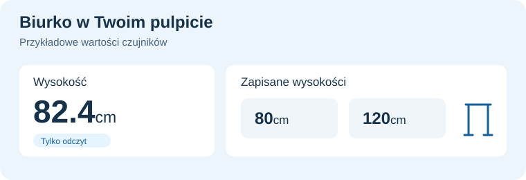

# LINAK dla Home Assistant

**Wysokość biurka w centymetrach, bezpośrednio w Home Assistant.**
Natywna integracja Bluetooth dla panelu LINAK **DPG1C**, instalowana przez HACS.

🇬🇧 [English](README.md) · 🇵🇱 **Polski**

> **Wersja alfa, tylko odczyt.** Odczyty sprawdzono na jednym DPG1C przy użyciu Maca. Odczyty na Malinie działały po ręcznym sparowaniu. Automatyczne pierwsze parowanie i proxy wymagają jeszcze testów. Ruch, Stop i zmiana ustawień panelu nie są jeszcze dostępne.

## 📏 Co zobaczysz

- **Czytelny pomiar wysokości:** centymetry z uwzględnieniem punktu odniesienia zapisanego na panelu.
- **Twoje zapisane pozycje:** podgląd wysokości zapamiętanych na biurku.
- **Ustawienia przypomnień w jednym miejscu:** wybrany profil i ustawione odstępy czasu.

Czasy przypomnień są ustawieniami, a nie licznikiem spędzonego czasu. Inne modele paneli nie mają potwierdzonej zgodności. [Pełna lista encji i wyniki testów →](.github/README.pl.md)

## 🏠 Biurko jako część Twojego pulpitu

Dodaj **Wysokość** do standardowej karty Home Assistanta i sprawdzaj pozycję biurka bez otwierania osobnej aplikacji. Zmiany wykonane fizycznym panelem docierają przez Bluetooth.

Podejrzyj w jednym miejscu zapisane wysokości do siedzenia i stania. Czujniki pokazują pamięć panelu; ich przeglądanie nie rozpoczyna ruchu. Czujniki przypomnień pokazują ustawione profile panelu, a nie wysyłają powiadomień na telefon.

### Czujniki w Home Assistant

- 📏 **Wysokość** jest głównym czujnikiem pomiarowym, w centymetrach.
- 🔖 **Zapisana wysokość 1–4** pokazuje do czterech pozycji pamięci, w centymetrach.
- 🔔 **Aktywny profil przypomnień** wskazuje wybrany profil.
- ⏱️ **Profil 1–3: czas siedzenia** i **czas stania** pokazują ustawione czasy, w minutach.
- 📐 **Korekta wysokości** pokazuje punkt odniesienia zapisany na panelu, w centymetrach.

Wysokość, zapisane pozycje i profile są zwykłymi czujnikami biurka. Korekta wysokości jest parametrem diagnostycznym. Ustawienia panelu odświeżają się co **60 sekund**. Przy utracie połączenia odczyty stają się niedostępne; HA ponawia próby, gdy integracja jest załadowana.

### Diagnostyka połączenia

- 🔗 **Połączenie** (`binary_sensor`): czy biurko ma gotowe połączenie i poprawne odczyty. Przy zerwaniu pokazuje stan rozłączony.
- 📶 **Siła sygnału Bluetooth** (`sensor`, dBm): ostatnia reklama odbierana przez HA, nie pomiar aktywnego łącza.
- 🛠️ **Backend Bluetooth** (`sensor`): np. lokalny BlueZ albo proxy ESPHome, bez nazwy adaptera.

RSSI i backend są domyślnie wyłączone. Możesz je włączyć w **Ustawienia → Urządzenia i usługi → Encje**, po pokazaniu wyłączonych encji LINAK. To włącza odczyt diagnostyczny w HA, bez zmiany ustawień biurka.

Nazwa i adres Bluetooth są w informacjach urządzenia. Pobierana diagnostyka pomija nazwę, MAC i identyfikatory adapterów. Diagnostyka pojawia się po pomyślnym dodaniu integracji; nie zastępuje komunikatów pierwszej konfiguracji.

## 📋 Czego potrzebujesz

- **Home Assistant 2026.10.4 lub nowszego**.
- Panelu **DPG1C** w zasięgu Bluetooth.
- Lokalnego adaptera Bluetooth albo zgodnego aktywnego **proxy Bluetooth ESPHome** z obsługą parowania.

Integracja działa bezpośrednio na urządzeniu z HA. Nie wymaga Maca ani osobnego mostka.

## 🚀 Instalacja i połączenie

1. W HACS dodaj `https://github.com/solarssk/ha-linak` jako własne repozytorium typu **Integracja / Integration**.
2. Pobierz **LINAK**, a następnie uruchom ponownie Home Assistant.
3. Zamknij aplikacje telefonu połączone z biurkiem i wyłącz integrację Idasen używającą tego samego biurka.
4. Włącz **parowanie Bluetooth** na panelu.
5. Otwórz **Ustawienia → Urządzenia i usługi → Dodaj integrację**. Wyszukaj **LINAK**, wybierz tę integrację niestandardową (`ha_linak`), a następnie swoje biurko. Możesz też użyć karty wykrytego urządzenia.

Konfiguracja łączy się, uwierzytelnia i odczytuje panel. Poczekaj do **60 sekund**, a po błędzie do kolejnych **10 sekund** na zwolnienie połączenia. Nieudana próba pokaże przyczynę i pozwoli spróbować ponownie.

Nie ma jeszcze wydania oznaczonego tagiem; HACS pobiera główną gałąź. [Instalacja ręczna i szczegółowy przewodnik →](.github/README.pl.md)

## 🛠️ Gdy coś nie działa

Sprawdź komunikat błędu i dziennik `ha_linak`. W zgłoszeniu podaj wersję HA i integracji, model panelu oraz informację, czy używasz lokalnego adaptera, czy proxy. Przed udostępnieniem logów usuń adresy Bluetooth i nazwy biurka.

[Konfiguracja i diagnostyka](docs/onboarding.md) · [Zgłoś błąd](https://github.com/solarssk/ha-linak/issues/new?template=bug.yml)

## 🪑 Zgodność i rozwój

**DPG1C jest pierwszym obsługiwanym panelem.** Siedem rozszerzonych zapytań odczytu sprawdzono na jednym fizycznym panelu przez macOS CoreBluetooth. Konfigurację, czujniki, błędy parowania i odzyskiwanie połączenia testujemy też wewnątrz HA z symulowanym Bluetooth.

Na Malinie zaobserwowano odczyty i ponowne połączenia po ręcznym sparowaniu hosta. Nowe automatyczne pierwsze parowanie i proxy ESPHome wymagają jeszcze testów. Zielony badge CI potwierdza testy oprogramowania, nie działanie każdego biurka i adaptera. [Wyniki testów sprzętowych →](docs/hardware-results.md)

Kolejny etap to stabilne sterowanie wysokością w **centymetrach**, Stop i wybór zapisanych pozycji po testach sprzętowych pod nadzorem. Te funkcje nie są jeszcze częścią wersji alfa. [Zobacz plan rozwoju →](docs/roadmap.md)

## 📚 Więcej informacji

[Przewodnik użytkownika](.github/README.pl.md) · [Lista zmian](CHANGELOG.md) · [Plan rozwoju](docs/roadmap.md) · [Współpraca](CONTRIBUTING.md)

[Badania protokołu](docs/protocol.md) · [Badania Bluetooth](docs/bluetooth-research.md) · [Jakość i utrzymanie](docs/governance.md)

Dokumentacja techniczna jest po angielsku. Niezależny projekt społecznościowy, niezwiązany z LINAK ani IKEA. Kod jest na licencji MIT; grafiki LINAK należą do ich właściciela. [Pochodzenie grafik](docs/branding.md).
