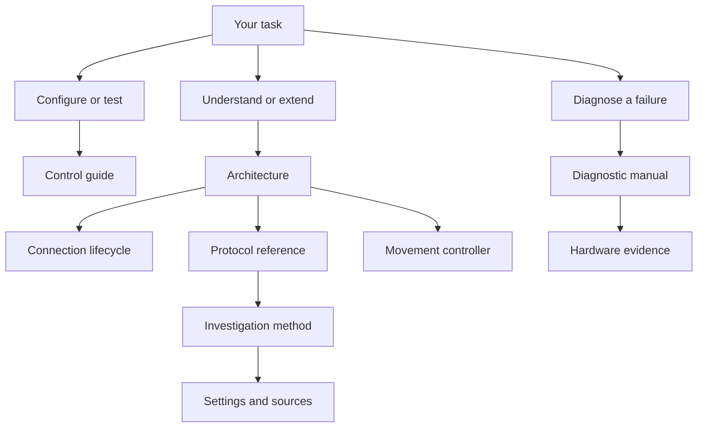

# LINAK documentation

Use these guides to configure a desk, diagnose a failed operation or change the integration. The documentation describes the current implementation and separates software guarantees from observations on one DPG1C. The integration runs inside Home Assistant on its host; a Mac is only an optional research environment.

## User guides

Use these pages to install and operate the integration:

| Guide | Language | Purpose |
| --- | --- | --- |
| [Marketplace product guide](../README.md) / [Polish guide](../README.pl.md) | English / Polish | Supported devices, entities, installation and settings |
| [GitHub product guide](../.github/README.md) / [Polish guide](../.github/README.pl.md) | English / Polish | Product overview and complete entity tables |
| [Control guide](controls.md) / [Polish owner guide](controls.pl.md) | Separate English / Polish pages | Configuration and controls; detailed acceptance procedure in English |
| [Troubleshooting](diagnostics.md) / [Polish reporting guide](diagnostics.pl.md) | Separate English / Polish pages | Report a problem, collect evidence and optionally draft with AI; technical error reference in English |

## Technical documentation

Use the references below to test another model, investigate communication or change the implementation. Product README files describe current user tasks; protocol decisions and hardware evidence belong here.

### Choose a reading path

| Your goal | Start with | Expected result |
| --- | --- | --- |
| Install through Marketplace | [English user guide](../.github/README.md) or [Polish user guide](../.github/README.pl.md) | Install and discover the integration |
| Test another panel or product family | [Device support and tester guide](device-support.md) | Understand matching, compatibility limits and evidence to report |
| Configure height and controls | [Control guide](controls.md) | Correct the height reference, set bounds and test a native control |
| Investigate a connection or movement failure | [Diagnostic manual](diagnostics.md) | Identify the failed layer and collect the evidence needed for the next test |
| Understand the implementation | [Architecture](architecture.md) → [connection lifecycle](onboarding.md) → [protocol](protocol.md) → [movement](movement.md) | Trace an HA action to its BLE exchange and cleanup |
| Extend the reverse engineering | [Investigation method and findings](bluetooth-research.md) → [hardware evidence](hardware-results.md) → [settings reference](settings-reference.md) | Distinguish a protocol candidate from a verified device behavior |

Technical references use English. Polish owner guides are separate `.pl.md` pages linked at the top of their English counterparts. They identify any English-only technical material before linking to it. Do not insert translated paragraphs into an English procedure.

## How the documents fit together

## Document responsibilities

Each reference owns one kind of information. Follow its links for related detail instead of treating every page as a complete manual.

| Document | Audience and purpose | Owns |
| --- | --- | --- |
| [Device support](device-support.md) | Tester or contributor assessing a device | Family matching, runtime compatibility matrix and tester reports |
| [Controls](controls.md) | Desk owner performing a task | Configuration steps and supervised HA test procedure |
| [Diagnostics](diagnostics.md) | Desk owner or maintainer investigating a failure | Symptom triage, evidence collection, diagnostic fields and privacy |
| [Onboarding](onboarding.md) | Developer tracing setup or reconnect | Authentication, wizard steps, session lifetime and error routing |
| [Architecture](architecture.md) | Contributor changing integration behavior | Current boundaries and proposed state/library contracts, entity model and operation ownership |
| [Protocol](protocol.md) | Developer implementing or reviewing exchanges | UUIDs, frames, units, parsing and response correlation |
| [Movement](movement.md) | Developer reviewing control behavior | Preparation, control loop, guards, deadlines and Stop cleanup |
| [Settings reference](settings-reference.md) | Contributor evaluating a new setting | Supported setters, calibration contract, feature inventory and source register |
| [Bluetooth investigation](bluetooth-research.md) | Maintainer designing a protocol experiment | Questions, investigation method, findings and unresolved tests |
| [Hardware evidence](hardware-results.md) | Reviewer assessing a behavior claim | Observations, limits and the hardware acceptance matrix |
| [Library comparison](communication-review.md) | Maintainer evaluating dependency reuse | Upstream contracts, differences and migration constraints |
| [Standalone experiment](movement-test.md) | Maintainer running a separate BLE tool | Runner prerequisites, arguments, result interpretation and recovery |

## Terms used in these guides

The guides distinguish radio discovery, transport authentication and application control readiness. These terms name those boundaries.

| Term | Meaning here |
| --- | --- |
| BLE | Bluetooth Low Energy, the radio/protocol stack used by the panel |
| GATT | Generic Attribute Profile: services, characteristics, reads, writes and notifications carried by the connection |
| BlueZ | Linux Bluetooth stack used by the local HA adapter |
| Backend / proxy | Software transport implementation / remote Bluetooth path managed by HA |
| RSSI | Received Signal Strength Indicator for an observed advertisement; not proof of a working control connection |
| Bond / pairing | Host-level Bluetooth authentication and retained keys |
| DPG client readiness | Application status checked separately from host pairing before protected control |
| Acknowledgement / readback | The panel accepts an application request / a later read verifies resulting state |

## Project maintenance

These references cover repository and presentation work rather than desk operation.

| Document | Purpose |
| --- | --- |
| [Roadmap](roadmap.md) | Assessed findings, delivery order, release gates and the path to HA Core |
| [Governance](governance.md) | CI gates, dependencies, repository policy and release boundaries |
| [Changelog](../CHANGELOG.md) | English-only public release notes, starting with the first public version |
| [Branding](branding.md) | Asset provenance, naming and artwork use |
| [Marketplace and GitHub presentation](hacs-presentation.md) | Separate README/brand surfaces, local routes, catalog limits and rendering checks |
| [Contributing](../CONTRIBUTING.md) | Report a bug, suggest an improvement or find development setup and contribution checks |
| [Agent instructions](../AGENTS.md) | Repository workflow for coding agents |

Public references explain the maintained behavior. CHANGELOG.md records release changes. Private handoff notes and raw captures remain outside the public documentation; names, addresses and client identifiers do not belong in examples.
