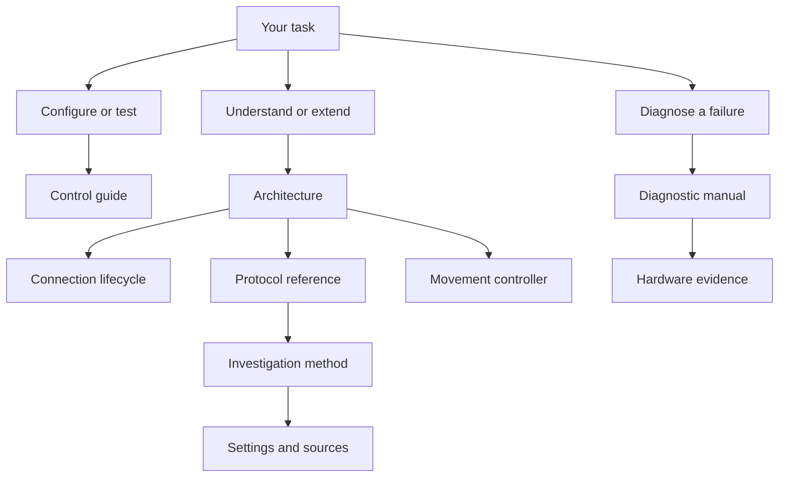

# LINAK Desks technical documentation

Use these guides to configure a desk, diagnose a failed operation or change the integration. The documentation describes the current implementation and separates software guarantees from observations on one DPG1C. The integration runs inside Home Assistant on its host; a Mac is only an optional research environment.

## Choose a reading path

| Your goal | Start with | Expected result |
| --- | --- | --- |
| Install through HACS | [English user guide](../.github/README.md) or [Polish user guide](../.github/README.pl.md) | Install and discover the integration |
| Configure height and controls | [Control guide](controls.md) | Correct the height reference, set bounds and test a native control |
| Investigate a connection or movement failure | [Diagnostic manual](diagnostics.md) | Identify the failed layer and collect the evidence needed for the next test |
| Understand the implementation | [Architecture](architecture.md) → [connection lifecycle](onboarding.md) → [protocol](protocol.md) → [movement](movement.md) | Trace an HA action to its BLE exchange and cleanup |
| Extend the reverse engineering | [Investigation method and findings](bluetooth-research.md) → [hardware evidence](hardware-results.md) → [settings reference](settings-reference.md) | Distinguish a protocol candidate from a verified device behavior |

Technical documents use English. Product guides and the HA interface also have Polish translations.

## How the documents fit together

## Document responsibilities

Each reference owns one kind of information. Follow its links for related detail instead of treating every page as a complete manual.

| Document | Audience and purpose | Owns |
| --- | --- | --- |
| [Controls](controls.md) | Desk owner performing a task | Configuration steps and supervised HA test procedure |
| [Diagnostics](diagnostics.md) | Desk owner or maintainer investigating a failure | Symptom triage, evidence collection, diagnostic fields and privacy |
| [Onboarding](onboarding.md) | Developer tracing setup or reconnect | Authentication, wizard steps, session lifetime and error routing |
| [Architecture](architecture.md) | Contributor changing integration behavior | Component boundaries, entity model, state and operation ownership |
| [Protocol](protocol.md) | Developer implementing or reviewing exchanges | UUIDs, frames, units, parsing and response correlation |
| [Movement](movement.md) | Developer reviewing control behavior | Preparation, control loop, guards, deadlines and Stop cleanup |
| [Settings reference](settings-reference.md) | Contributor evaluating a new setting | Supported setters, calibration contract, feature inventory and source register |
| [Bluetooth investigation](bluetooth-research.md) | Maintainer designing a protocol experiment | Questions, investigation method, findings and unresolved tests |
| [Hardware evidence](hardware-results.md) | Reviewer assessing a behavior claim | Test method, observation, conclusion and limits for each finding |
| [Library comparison](communication-review.md) | Maintainer evaluating dependency reuse | Upstream contracts, differences and migration constraints |
| [Standalone experiment](movement-test.md) | Maintainer running a separate BLE tool | Runner prerequisites, arguments, result interpretation and recovery |

## Project maintenance

| Document | Purpose |
| --- | --- |
| [Roadmap](roadmap.md) | Remaining implementation and validation work |
| [Governance](governance.md) | CI gates, dependencies, repository policy and release boundaries |
| [Branding](branding.md) | Asset provenance, naming and artwork use |
| [HACS presentation](hacs-presentation.md) | Separate GitHub/HACS renderers, supported Markdown and rendering checks |
| [Contributing](../CONTRIBUTING.md) | Development setup, required checks and documentation conventions |
| [Agent instructions](../AGENTS.md) | Repository workflow for coding agents |

Public references explain the maintained behavior. CHANGELOG.md records release changes. Private handoff notes and raw captures remain outside the public documentation; names, addresses and client identifiers do not belong in examples.
