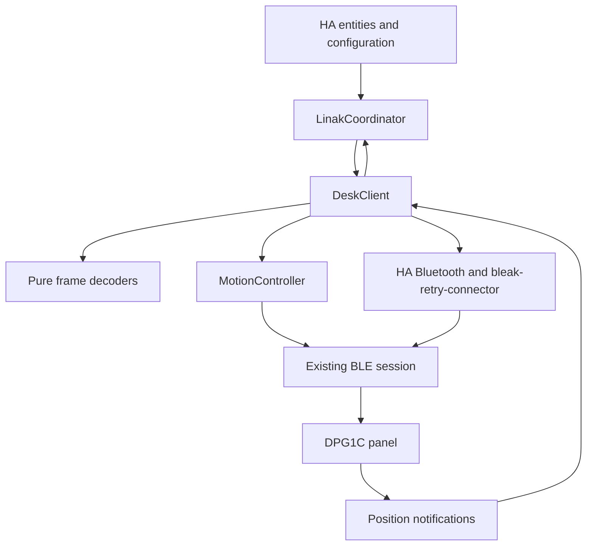

# How the integration manages desk state and control

LINAK Desks is a native Home Assistant integration distributed through HACS. Home Assistant owns discovery and adapter selection; one coordinator and one BLE client own each configured desk. The initial hardware target is DPG1C, not every LINAK actuator or product family.

## Component boundaries

An entity requests an operation through the coordinator. It never creates a Bluetooth connection itself.

| Component | Responsibility | Boundary |
| --- | --- | --- |
| `config_flow.py` | Discovery, setup, explicit preparation and configuration | No movement during setup; HA naming does not rename the panel |
| `setup_session.py` | One-time transfer from setup to runtime | Transfer stays in memory and expires if unconsumed |
| `coordinator.py` | Shared state, availability, polling and HA action errors | Uses the existing client; does not resume old targets |
| `client.py` | Connection, pairing, subscriptions, serialized queries and exclusive operations | Discards ambiguous sessions rather than assigning uncertain replies |
| `protocol.py` | Frame validation and decoding | No Bluetooth I/O or setting policy |
| `calibration.py` | Measurement proposal and offset encoding | No transport or unrestricted setting-write API |
| `motion.py` | Target loop, feedback guards and Stop cleanup | Uses an already connected, exclusively owned session |
| Entity platforms | HA values, units, categories and actions | Publish measured feedback, not an assumed target result |

## Entity contract

Centimeters are the primary height interface. A `number` entity supports that interface without a percentage-based cover or a custom frontend card.

| HA surface | Data or action | Category |
| --- | --- | --- |
| Height sensor | Current position plus panel offset | Ordinary sensor |
| Stored-height sensors | Saved mechanism positions plus current offset | Ordinary sensors |
| Active profile and profile-duration sensors | Reminder configuration read from the panel | Ordinary sensors |
| Target height number | Whole-centimeter target within measured bounds; state follows actual feedback | Control |
| Stored-position buttons | Freshly read slot passed to the common movement controller | Controls |
| Stop button | Interrupt an active operation or send Stop while idle | Control |
| Offset sensor | Technical reference used in height conversion | Diagnostic |
| Connection binary sensor | Current client readiness | Diagnostic, enabled by default |
| Signal strength and backend sensors | Advertisement RSSI and active backend category | Diagnostic, disabled by default |

Raw position, offset and stored positions retain their precision. Height-related sensor states and new history records use whole centimeters. Slider bounds round inward: `ceil(minimum)` and `floor(maximum)`. The slider uses 1 cm targets; stored-position buttons retain exact stored positions. Presentation rounding cannot expand the command range.

Device identity uses the `ha_linak` domain and Bluetooth address. Existing entity unique IDs remain stable. HA names and `name_by_user` belong to HA registries; they are separate from the advertised/GAP name. Downloaded diagnostics omit those identifiers.

## State and freshness

The current implementation has one shared availability boundary for panel readings.

| State | Source | On disconnect | Persistence |
| --- | --- | --- | --- |
| Position and speed word | Height reads and notifications | Ordinary readings become unavailable | No target or motion replay |
| Offset, memories and reminders | Serialized DPG refresh | Last objects may remain in memory, but entities report unavailable | No durable stale-settings snapshot yet |
| Measured command bounds | HA options | Retained for later validation | Stored in the config entry; do not program firmware limits |
| Explicit HA name | HA entry and device registry | Retained | Stored independently of discovery metadata |
| RSSI | HA connectable advertisement cache | Can remain available independently of the session | No extra GATT request |

A full refresh currently runs every 60 seconds. Height notifications can update actual position between refreshes. Polling yields while a control operation owns the client. Separating settings freshness from live connection health is planned, not an implemented cache feature.

## Operation ownership

One desk must have one active owner of its BLE connection. The client reserves a foreground operation before awaiting I/O and uses one query lock to serialize its exchanges.

| Operation | Shared lock/ownership | Possible panel side effects |
| --- | --- | --- |
| Discovery or ordinary refresh | Serialized reads | GATT writes carrying read requests only |
| Confirmed setup preparation | Foreground preparation | Verified activation of the existing client when inactive |
| Confirmed height calibration | Calibration reservation and query lock | Verified activation and one offset correction |
| Explicit target or stored-position drive | Movement reservation and query lock | Verified client activation if needed, then wake/target/Stop |
| Stop | Separate shared Stop task; preempts motion | Stop only when idle; no activation or target |
| Unload/shutdown | Waits for owned cleanup | Attempts final Stop and releases the link |

A second target or calibration cannot compete with an active operation. Cancellation and unload wait for bounded cleanup. A session failure never queues a target for later reconnect. See the [movement reference](movement.md) for the controller and the [settings reference](settings-reference.md#height-calibration-contract) for calibration.

## Connection and recovery

The [connection lifecycle](onboarding.md) defines authentication, setup transfer and retry. HA supplies current connectable device metadata; the integration does not force `hci0`, clear unrelated bonds or choose a proxy by name.

A backend disconnect cancels pending I/O. Ambiguous query failures invalidate the session because some DPG replies do not identify their request. The coordinator attempts recovery through its normal refresh schedule and reports stale readings unavailable. Reconnection performs reads only; a later explicit control request must validate its own readiness and bounds.

## Supported environment and evidence

Automated tests run against HA 2026.10.4 with simulated Bluetooth. The [hardware evidence](hardware-results.md) covers one DPG1C on macOS and a Raspberry Pi 4B. Complete target arrival, physical Stop accuracy, fresh unbonded onboarding and mixed-adapter stability remain open validation work. No Home Assistant quality-scale award or HACS default-catalog acceptance is claimed.
