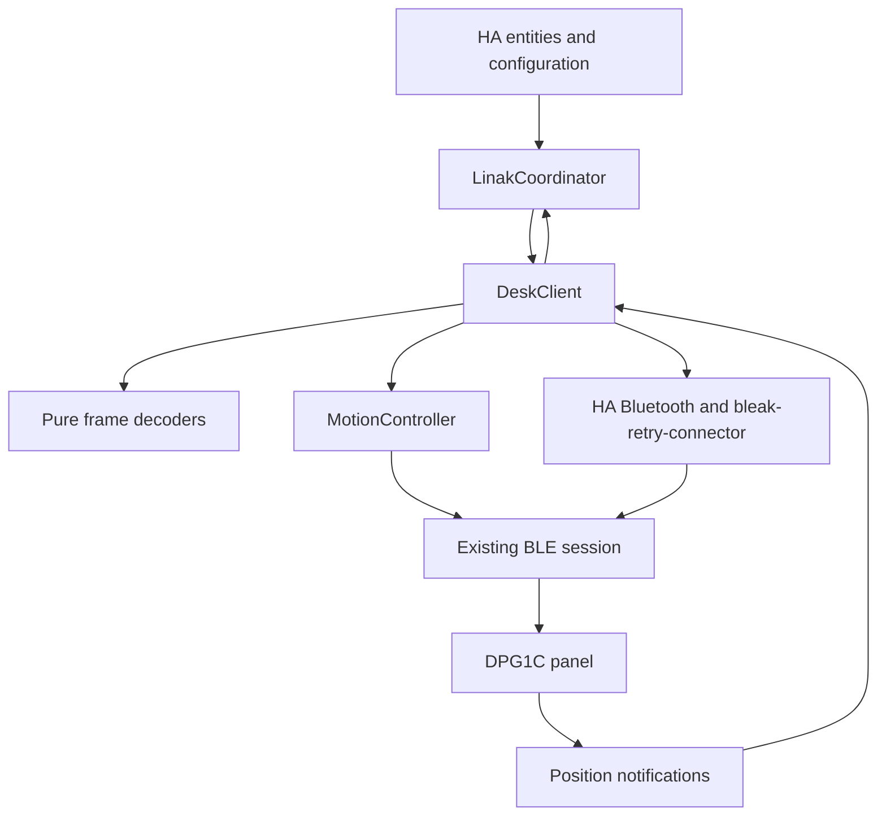
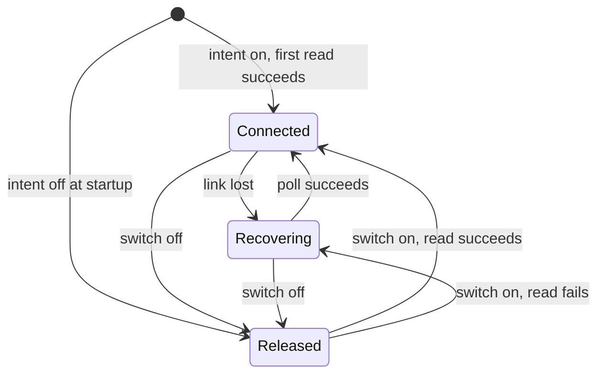
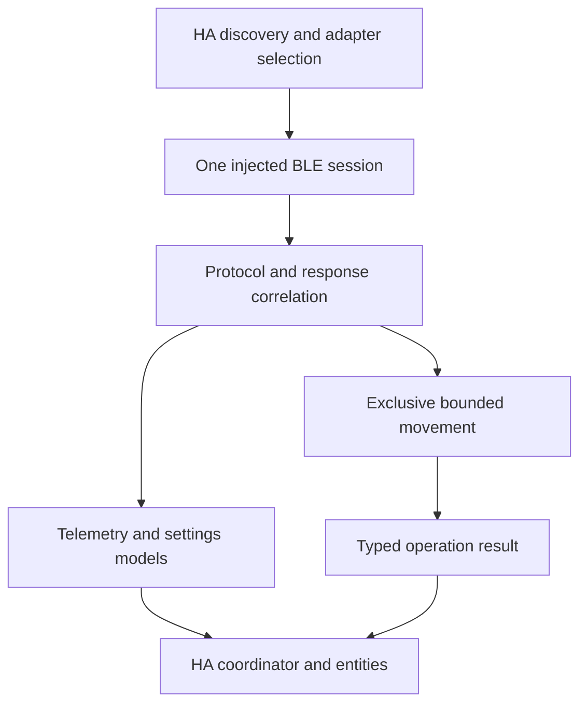

# How the integration manages desk state and control

LINAK Desks is a native Home Assistant integration distributed through HACS. Home Assistant owns discovery and adapter selection; one coordinator and one BLE client own each configured desk. The initial hardware target is DPG1C, not every LINAK actuator or product family.

## Component boundaries

An entity requests an operation through the coordinator. It never creates a Bluetooth connection itself.

| Component | Responsibility | Boundary |
| --- | --- | --- |
| `config_flow.py` | Discovery, setup, explicit preparation and configuration | No movement during setup; HA naming does not rename the panel |
| `setup_session.py` | One-time transfer from setup to runtime | Transfer stays in memory and expires if unconsumed |
| `coordinator.py` | Shared state, availability, polling and HA action errors | Uses the existing client; does not resume old targets |
| `client.py` | Connection, pairing, subscriptions, serialized queries and exclusive operations | Discards ambiguous sessions rather than assigning uncertain replies |
| `protocol.py` | Frame validation and decoding | No Bluetooth I/O or setting policy |
| `calibration.py` | Measurement proposal and offset encoding | No transport or unrestricted setting-write API |
| `motion.py` | Target loop, feedback guards and Stop cleanup | Uses an already connected, exclusively owned session |
| Entity platforms | HA values, units, categories and actions | Publish measured feedback, not an assumed target result |

## Entity contract

Centimeters are the primary height interface. A `number` entity supports that interface without a percentage-based cover or a custom frontend card.

| HA surface | Data or action | Category |
| --- | --- | --- |
| Height sensor | Current position plus panel offset | Ordinary sensor |
| Stored-height sensors | Saved mechanism positions plus current offset | Ordinary sensors |
| Active profile and profile-duration sensors | Reminder configuration read from the panel | Ordinary sensors |
| Target height number | Whole-centimeter target within measured bounds; state follows actual feedback | Control |
| Stored-position buttons | Freshly read slot passed to the common movement controller | Controls |
| Stop button | Interrupt an active operation or send Stop while idle | Control |
| Operation sensor | Phase of the explicit request; a settled result returns to idle after a pause and stays in the last-result attributes; never a measurement | Ordinary sensor, available without a Bluetooth link |
| Keep connected switch | The owner's intent to hold the Bluetooth link, persisted on the config entry; not the observed link | Configuration control, disabled by default, available without a Bluetooth link |
| Offset sensor | Technical reference used in height conversion | Diagnostic |
| Connection binary sensor | Current client readiness | Diagnostic, enabled by default |
| Signal strength and backend sensors | Advertisement RSSI and active backend category | Diagnostic, disabled by default |

Raw position, offset and stored positions retain their precision. Height-related sensor states and new history records use whole centimeters. Slider bounds round inward: `ceil(minimum)` and `floor(maximum)`. The slider uses 1 cm targets; stored-position buttons retain exact stored positions. Presentation rounding cannot expand the command range.

Device identity uses the `ha_linak` domain and Bluetooth address. Existing entity unique IDs remain stable. HA names and `name_by_user` belong to HA registries; they are separate from the advertised/GAP name. Downloaded diagnostics omit those identifiers.

## State and freshness

Live height requires a validated connection and reference. Optional memories and reminders additionally have independent response-validity metadata during runtime refresh; initial setup and calibration verification still require complete validated reads.

| State | Source | On disconnect | Persistence |
| --- | --- | --- | --- |
| Position and speed word | Height reads and notifications | Ordinary readings become unavailable | No target or motion replay |
| Offset | Required serialized reference read | Dependent readings become unavailable with the link | No assumed reference from a previous generation |
| Memories and reminders | Serialized optional groups with validity and last-success age | Cached objects remain only in memory; their entities report unavailable when the group or link is invalid | No durable snapshot or stale-as-live values |
| Measured command bounds | HA options | Retained for later validation | Stored in the config entry; do not program firmware limits |
| Explicit HA name | HA entry and device registry | Retained | Stored independently of discovery metadata |
| RSSI | HA connectable advertisement cache | Can remain available independently of the session | No extra GATT request |

Config-entry setup defers all radio work until HA reaches running, using HA's started-event retry. The initial post-start connection/read has the 60-second refresh budget plus bounded cleanup; HA owns later retries and platforms are created only after a successful read. The normal runtime check reads capabilities, offset and position every 60 seconds. Height notifications update position between these checks without resetting the polling deadline; identical samples are not republished. Memories and reminders have independent five-minute due checks based on each group's last successful monotonic timestamp. A skipped read preserves both its last value and timestamp. Invalid groups retry on the next runtime check without rereading a healthy group that is not due. Reconnection, changed capabilities or a changed offset forces both groups to be read. Foreground setup/calibration keeps full reads; movement still reads its conversion reference and selected memory under exclusive ownership.

| Freshness term | Meaning in this integration | HA behavior |
| --- | --- | --- |
| Not read | No validated value in this process/session | Unknown data is never substituted with zero |
| Valid live height | Position from this ready session plus its validated reference | Notifications publish height; periodic reference/position checks continue during notification traffic |
| Valid last-read setting | A successfully decoded group in this ready session | Displayed until a scheduled check, reference change or disconnect; age is time since the group read, not since any notification |
| Invalid group | A completed matching reply failed decoding | That group's entities are unavailable; another group's valid read can remain available |
| Lost or ambiguous session | Disconnect, timeout, invalid reference or other transport failure | All ordinary readings become unavailable; cached objects are diagnostic history only |

The five-minute interval is an explicit software read policy, not evidence of an overloaded controller or proof that the OLED sleeps. During an unchanged four-slot session, the synthetic request count is two extended reads per normal check instead of ten; a due full check retains the existing memory barriers. Polling yields while control owns the client, so deadlines are not hard real-time guarantees. The number entity holds its last settled height during travel while the measurement sensor stays live. All timeouts still invalidate the transport generation; recovery creates a session with fresh required data and settings, never a cached height or queued target. The operation sensor reports explicit requests apart from this telemetry, and deliberate connection ownership is described in [Deliberate connection ownership](#deliberate-connection-ownership).

## Operation ownership

One desk must have one active owner of its BLE connection. The [cross-integration check](onboarding.md#one-integration-per-desk) rejects known enabled IKEA entries for the same address before new LINAK I/O. Idle refresh releases our connection on conflict; Stop and cleanup retain their existing ownership rules. This registry check is not a system-wide Bluetooth mutex. The client reserves a foreground operation before awaiting I/O and uses one query lock to serialize its exchanges.

| Operation | Shared lock/ownership | Possible panel side effects |
| --- | --- | --- |
| Discovery or ordinary refresh | Serialized reads | GATT writes carrying read requests only |
| Confirmed setup preparation | Foreground preparation | Verified activation of the existing client when inactive |
| Confirmed height calibration | Calibration reservation and query lock | Verified activation and one offset correction |
| Explicit target or stored-position drive | Movement reservation and query lock | Verified client activation if needed, then wake/target/Stop |
| Stop | Separate shared Stop task; preempts motion | Control Stop and reference release when idle; no activation or height target |
| Unload/shutdown | Waits for owned cleanup | Attempts final Stop and releases the link |

A second target or calibration cannot compete with an active operation. Cancellation and unload wait for bounded cleanup. A session failure never queues a target for later reconnect. See the [movement reference](movement.md) for the controller and the [settings reference](settings-reference.md#height-calibration-contract) for calibration.

## Connection and recovery

The [connection lifecycle](onboarding.md) defines authentication, setup transfer and retry. HA supplies current connectable device metadata; the integration does not force `hci0`, clear unrelated bonds or choose a proxy by name.

A backend disconnect cancels pending I/O. Ambiguous query failures invalidate the session because some DPG replies do not identify their request. The coordinator attempts recovery through its normal refresh schedule and reports stale readings unavailable. Reconnection performs reads only; a later explicit control request must validate its own readiness and bounds.

### Deliberate connection ownership

The **Keep connected** switch holds the owner's intent. It is kept apart from the observed link that the Connection sensor reports.

- The intent is stored as `keep_connected` in the config entry data. It defaults to on when the key is absent and survives a restart.
- Options flows replace only the options, so they cannot reset it. Changing it does not reload the entry.
- The switch is a configuration entity that is disabled by default, so the owner enables it on purpose.
- The stored intent applies whether or not the entity is enabled. Disabling the entity while the desk is released does not reconnect it. The owner turns it on again after re-enabling the entity.

| State | Intent | Radio activity | Readings |
| --- | --- | --- | --- |
| Connected | On | Normal polling and reads | Live |
| Recovering | On | Normal retry schedule after a failed connection | Unavailable until a read succeeds |
| Released | Off | None: no device lookup, connection or poll | Unavailable; the cached values are not shown as live |

**Turning it off**

- The intent is saved first, so a restart or a refresh already in flight sees the latest choice.
- Any active movement is stopped through the normal bounded Stop. Then the link is dropped and the readings become unavailable, even when dropping the link itself fails.
- A Stop that cannot be confirmed is reported as a failed Stop. The link stays released and the intent stays off.
- A refresh already in flight is not cancelled. It finishes, is discarded because the intent changed, and the link is dropped again instead of publishing the result.

**While released**

- The client refuses to connect, so only an explicit turn-on can reconnect it.
- A scheduled poll still fires but returns before any radio lookup.

**Turning it on**

- The client resumes and performs one normal connection and read, with the same bounded timeout.
- Every group is read afresh, because the earlier link loss invalidated them.
- It never sends a target, calibrates or activates a client.
- On failure the intent stays on, the action reports `connection_failed` and the normal poll retries.

**Overlapping requests**

- Actions are serialized and the newest request wins. An earlier request that a later one superseded does nothing.
- A turn-off waits behind a running turn-on refresh, at most the 60-second refresh budget. Its intent is saved immediately and that refresh is discarded.

**Startup and scope**

- A persisted release starts without waiting for the desk or for Home Assistant's Bluetooth discovery.
- It loads the entities this entry registered earlier as unavailable, releases any link still held by the setup wizard, and adds stored-position entities that the first connection reveals.
- The IKEA conflict check is independent: it still releases only LINAK's own link and never changes another entry.
- A released desk is not evidence of panel sleep or OLED behavior. That needs a separate supervised observation.

## Supported environment and evidence

Automated tests run against HA 2026.10.4 with simulated Bluetooth. The [hardware evidence](hardware-results.md) covers one DPG1C on macOS and a Raspberry Pi 4B. Complete target arrival, physical Stop accuracy, fresh unbonded onboarding and mixed-adapter stability remain open validation work. No Home Assistant quality-scale award or HACS default-catalog acceptance is claimed.

## Proposed state and library contracts

This section defines the intended refactoring boundary, not implemented state fields or a published library API. The [delivery plan](roadmap.md#delivery-order) sequences migration and acceptance tests. Keep runtime fixes small while the contract is established.

| Model | Required information | Trust boundary |
| --- | --- | --- |
| Telemetry sample | Raw position, speed word, observation time and connection generation | A sample from a closed generation cannot become current after reconnect |
| Configuration snapshot | Reference, memories, reminders, per-group read time and validity | Last-read configuration is not permission to move; unknown/unsupported differs from a failed read |
| Connection state | Disconnected, connecting, authenticating, ready, recovering or deliberately suspended | Suspension must not trigger a polling-driven reconnect; readiness is not a movement result |
| Operation result | Operation identifier, kind, requested goal, phase, start/end time and typed outcome/reason | Reject competing goals without queueing; successful explicit Stop is interrupted rather than failed. The operation sensor implements the phase, requested goal, outcome and reason; the identifier, kind and timestamps remain proposed |
| Device capabilities | Protocol flags, implemented operations and evidence-supported model/firmware scope | An advertised bit does not establish a working setter or compatibility with another family |

A settings snapshot may be displayed as last-read data only with explicit freshness semantics. Fresh height needs a valid sample and reference for the current connection. An offset change invalidates derived height and configured control assumptions until reconciled; it must not silently reinterpret old measurements. Reconnect can recover telemetry before optional settings, but cannot authorize target travel from an uncertain reference or memory response.

| Responsibility | Future library | HA integration |
| --- | --- | --- |
| Transport | Accept injected BLE device/connector and callbacks; own one session | Resolve HA Bluetooth candidates and connection policy; do not add a second reconnect manager |
| Protocol | Validate/decode frames, correlate requests, invalidate ambiguous generations | Translate supported data and errors into HA concepts |
| Movement | Bound targets and I/O, prioritize Stop, retain cleanup ownership | Accept explicit actions and provide translated busy/error messages |
| Settings | Separate pure preview from explicit acknowledged writes/readback | Present confirmation and persist host preferences |
| Lifetime | Explicit async connect/close, removable subscriptions and bounded cancellation | Config-entry startup/retry, unload and registry lifecycle |
| Diagnostics | Typed reasons, durations and counts with no raw private identifiers by default | HA diagnostics/redaction, repairs and diagnostic entities |
| Capabilities | Describe known protocol support without assuming every model works | Create only supported entities and preserve existing entity identity |

Start with the existing protocol/calibration models and narrow transport interfaces. Library modules must not import HA, and entities must not parse wire packets. Use typed immutable snapshots/events at the boundary rather than exporting the client's mutable state or backend exceptions as a public API. Select public method and package names in the extraction design; this table is not a promise that a `python-linak` package already exists.

Before changing the import path, run the same synthetic frame, duplicate-response, cancellation, Stop, bounds and redaction cases against the candidate library and HA adapter. The duplicate-response baseline is `tests/test_protocol_replay.py`. Keep packet-order or polling-policy changes in separate reviewed patches. Validate dependency license compatibility, source distribution, tagged version and public build/publish provenance before publishing or adding a package dependency. The [HA library requirements](https://contributors.home-assistant.io/core/integrations/api-library/) own those external acceptance rules.
