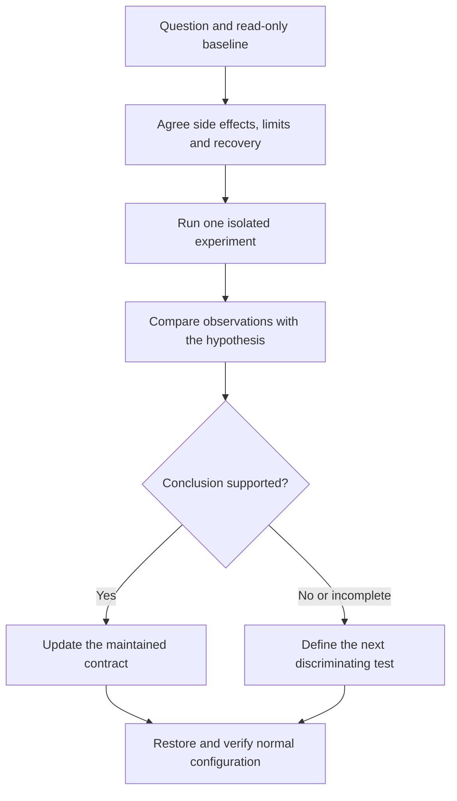

# Investigate the DPG1C Bluetooth protocol

This guide explains how to turn a desk symptom into a testable protocol question, compare existing implementations and validate a conclusion. It connects the maintained protocol reference to the hardware evidence. It is not a log of individual debugging sessions.

## Investigation goals

The integration needs to read panel configuration, present correct centimeter heights and execute explicit controls through HA-managed Bluetooth. Each goal requires separate evidence.

| Question | Why it matters | Required observation |
| --- | --- | --- |
| Can the host authenticate and subscribe? | Discovery alone cannot load reliable sensors | Host authentication result and validated replies |
| Which reference converts relative position to desktop height? | A fixed IKEA datum can produce wrong heights | Offset response, relative position and a physical measurement |
| Can replies be assigned to the right request? | Memory replies do not contain a slot identifier | Request ordering and duplicate-signal behavior |
| Does this client have application-level control readiness? | Readable sensors do not imply writable controls | Client status, acknowledged activation and unchanged identifier |
| Does the desk reach and stop at a target? | Successful writes do not prove physical behavior | Fresh feedback, observed direction/arrival and physical Stop |
| Does behavior depend on the selected adapter? | HA can select local or proxy paths | Actual backend and a controlled path comparison |

## Use the appropriate source

Product documentation, community code, software tests and hardware observations answer different questions.

| Source class | Use it for | Do not infer |
| --- | --- | --- |
| Manufacturer manuals/data sheets | UI functions, variants, physical operation and product constraints | An undocumented BLE payload or permission to write it |
| Pinned community implementations | Candidate framing, units, ordering and response handling | Manufacturer authority or compatibility with this firmware |
| Automated tests | Parser, state machine, deadline and cleanup contracts | Physical movement or radio reliability |
| Hardware capture plus physical observation | Behavior of the tested panel/host/path | General support across models or firmware |

Use the [source register](settings-reference.md#source-register) for exact documents and pinned revisions. The [library comparison](communication-review.md) explains why existing Idasen work is relevant without making its constants or ownership policy universal.

## Design one experiment

State the question and expected outcomes before connecting or writing. A useful record lets another maintainer repeat the method and distinguish the conclusion from a guess.

1. Identify the failing layer using the [diagnostic manual](diagnostics.md). Keep discovery, GATT connection, bonding, subscriptions, DPG reads, application readiness and movement separate.
2. Establish the exact source revision and environment. Record model/variant, HA/OS/library versions, characteristic properties and actual backend; mark unknown values explicitly.
3. Capture a read-only baseline. Save current position/reference, relevant settings, client status when needed and the symptom's first failing stage.
4. Define one changed condition and an outcome that would disprove the hypothesis. Examples include local versus proxy transport, a reply barrier or preserved-identifier activation.
5. Obtain explicit scope for any setting write, bond operation or movement. Define the maximum movement, Stop method, cleanup and recovery before the attempt.
6. Run one isolated client. Disable competing desk integrations for the agreed interval; do not modify unrelated Bluetooth devices.
7. Compare observed frames, feedback and physical behavior with the expected outcomes. Record uncertain results instead of retrying until one happens to work.
8. End the diagnostic client, restore the intended integration/adapter state and verify fresh reads. Publish only redacted findings and synthetic examples.

## Established findings and implementation consequences

The evidence register contains the complete method and limits for each finding. This table explains why the implementation differs from a generic BLE example.

| Finding | Evidence | Implementation consequence | Remaining uncertainty |
| --- | --- | --- | --- |
| A local BlueZ pair can fail without a confirmation agent | [Authentication evidence](hardware-results.md#bluetooth-authentication) | Pair through a private agent and Device1 on the same D-Bus connection | Fresh unbonded onboarding and proxy pairing |
| DPG configuration needs notification replies, not a direct characteristic read | [Extended reads](hardware-results.md#extended-configuration-reads) | Subscribe, serialize and validate response type/length | Other firmware layouts |
| A duplicated memory reply can shift later slots | [Reply ordering](hardware-results.md#stored-position-response-ordering) | Interleave a different response type as a read-only barrier | Cause of BlueZ signal multiplication and arbitrary reordering |
| Valid reads can coexist with inactive client status | [Movement readiness](hardware-results.md#client-readiness-and-movement) | Check readiness before explicit control; preserve the identifier | Status lifetime across firmware/restart conditions |
| Offset correction needs acknowledgement and independent readback | [Calibration](hardware-results.md#height-reference-calibration) | One confirmed write, no replay, refresh dependent heights | Power-cycle persistence and other variants |
| Disconnecting between wizard steps can prevent a later step from reconnecting | [Session continuity](hardware-results.md#setup-session-continuity) | Reuse the validated foreground session and transfer it to runtime | Broader reconnect reliability |
| A motion guard can deliberately precede a disconnect | [Movement readiness](hardware-results.md#client-readiness-and-movement) | Log the guard reason and backend before cleanup | Complete travel and physical Stop accuracy |

## Control traffic and state freshness

A full settings refresh currently runs every 60 seconds. This is an implementation schedule, not evidence that the desk requires a settings keepalive. Target keepalives serve a different purpose and exist only during explicit movement.

Do not reduce traffic by making stale telemetry look current. A future refresh design must separate live position, last-read panel configuration and host preferences, then define which settings survive restart with a visible age. The current implementation has no durable stale-settings snapshot. See [state and freshness](architecture.md#state-and-freshness).

## Next tests that can change a conclusion

Choose the test that distinguishes the remaining explanations, rather than repeating a successful read-only baseline.

| Open question | Discriminating test | Required limits |
| --- | --- | --- |
| Full target movement after readiness preparation | Supervised short upward and downward targets with fresh feedback and tape measurement | Bounded target, physical stopping access, no unattended replay |
| Physical Stop accuracy | Interrupt confirmed physical movement and measure stop behavior | Separate observation from software `stop_sent` |
| Client status lifetime | Compare read-only status on the same session, new session, HA restart and agreed panel power cycle | No identifier replacement; do not assume persistence from one reconnect |
| Mixed adapters | Repeat the same read/control case on local-only, proxy-only and mixed paths | Record actual backend and restore original configuration |
| Automatic first pairing | Agreed unbonded test on the intended host/backend | Do not remove a working bond without scope |
| Target cadence and physical-panel handback | Two-channel Stop and short target sequences are trace-observed; compare physical gestures after HA travel | One change per bounded experiment; retain all movement guards |
| OLED remains lit during inactivity | Compare visible OLED and reminder strip with no client, a quiet connected client and periodic reads | Quiet GATT is not proof of screen sleep; do not infer a sleep opcode |
| New panel setters | Verify encoding, unrelated-bit preservation, acknowledgement, readback and persistence | No generic arbitrary-write control or guessed safe bounds |

A capture can show a host-visible disconnect without its radio-level reason. Record that reason as unknown unless an actual controller/HCI event supplies it. Private identifiers, raw device objects and unredacted bus/radio traces stay outside the repository.
