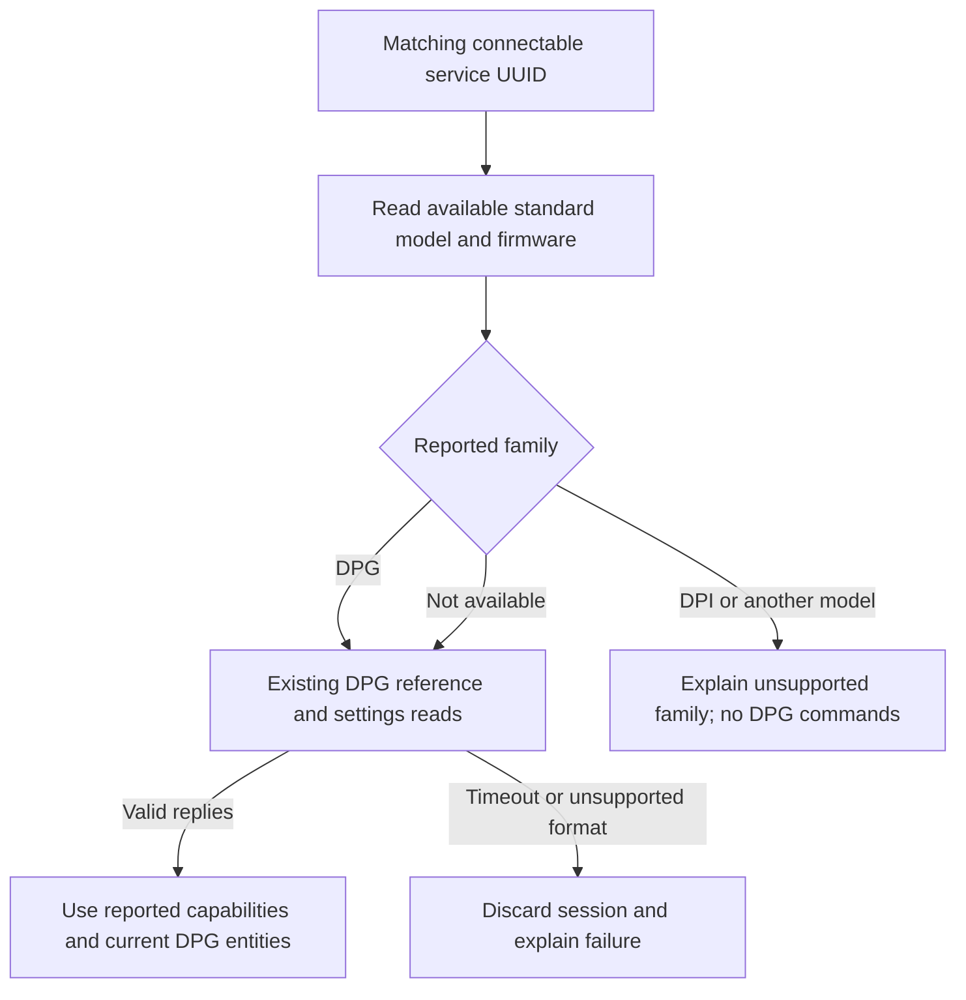

# Device families, compatibility and tester reports

LINAK is the integration name. Its first implemented protocol profile is for DPG desk panels. A shared manufacturer, Bluetooth address prefix, panel appearance or app does not establish a shared protocol. Additional families, such as DPI panels or adjustable beds, need their own identified protocol profile and validation before their controls can be offered.

## How discovery becomes a supported device

Discovery currently matches service `99fa0001-338a-1024-8a49-009c0215f78a`. The MAC address identifies an entry and detects ownership conflicts; it does not choose a driver. The advertised desk name is user-configurable and is not used as a model identifier.

On a new connection the client reads standard Device Information characteristics for Model Number (`2a24`) and Firmware Revision (`2a26`), if readable characteristics exist. These reads occur once per session, not on each refresh. Permission errors or absent fields leave the model unknown; a timeout or link loss still discards the session. Metadata reads share the existing refresh deadline and each read has the existing ten-second I/O bound. No discovery of unrelated services or manufacturer-wide MAC scan is added.

Recognized model values are a family name (`DPG`, `DPI`) or its compact variant, such as `DPG1C`, `DPG1M`, `DPG1B`, `DPG1I` or `DPI1C`. Numeric ordering suffixes, such as `DPG1C32-000016`, are reduced to the compact model `DPG1C`; the suffix is not exported. Other nonempty model strings are not silently treated as DPG. OEM part numbers outside these formats need a reviewed identity rule and a tester report. Missing or invalid metadata preserves the existing DPG protocol probe, because some compatible devices provide no exact model. A passed probe confirms the implemented response format, not a specific product model or physical motion behavior.

The HA device page shows the recognized model and version-shaped firmware when available. It no longer invents `DPG` for an unidentified device. A name entered by the owner, the integration domain and entity identifiers remain unchanged.

## Compatibility matrix

| Family or configuration | Identity and protocol handling | Available implementation | Hardware evidence |
| --- | --- | --- | --- |
| DPG1C | DPG profile, valid reference/settings replies required | Height, declared memories, reminders, bounded movement, Stop and confirmed height calibration | Read exchanges and limited control observations on one panel; full acceptance remains open |
| Other DPG variants | Recognized as DPG; each must pass the same implemented response contract | Memory count follows reported capabilities, not the model name; other features need independent checks | No model-specific validation; do not advertise support from a passed probe alone |
| Device with no readable model | Existing DPG probe, model remains unknown | Current DPG functions only after valid replies | Exact panel and firmware need a tester report |
| DPI | Family recognized, no implemented driver; rejected before DPG subscription/query/activation | None | Requires its own protocol and hardware evidence |
| Another reported model, including bed or seating controllers | No matching driver; rejected before DPG commands | None | Not supported; no desk movement semantics are inherited |
| External Bluetooth adapter | The adapter's identity may differ from the panel/control box | Not established by recognizing a manufacturer or UUID | Record both adapter and attached product before assessing support |

The [model and variant reference](settings-reference.md#model-and-variant-matrix) owns manufacturer feature descriptions and source inconsistencies. The [hardware evidence register](hardware-results.md) owns physical observations. This matrix owns runtime matching and tester eligibility, not a list of all LINAK products.

## Capabilities have three different meanings

| Evidence layer | Source | What it establishes |
| --- | --- | --- |
| Reported | Raw capability flags and memory count in diagnostics `state.capabilities` | What the device reports; an automatic-drive bit is not permission to move |
| Implemented and observed | `device_profile.driver`, `protocol_validated`, `settings` validity and the current state | Which driver completed the read contract and which setting groups have valid replies |
| Physically validated | Model/variant, firmware, host/backend and results in the hardware evidence register | What someone actually observed, including Stop and physical panel handback |

Diagnostics use `hardware_validation: not_inferred`: recognizing a model never promotes it to hardware-validated status. `protocol_validated` records a successful read contract on the current or last session; it is reset when a new session starts. It is not a live connection indicator. Use `connected` and setting validity for current availability.

Only the declared zero to four memory slots are queried and exposed. The reminder-light flag does not prove the reminder read contract. The current DPG setup still requires valid reminder replies, so a panel without that query cannot yet use a reduced height-only profile. A timeout cannot be treated as an absent feature and ignored on the same connection: request/reply assignment would be uncertain. A future reduced profile must identify unsupported features before sending their queries and retain the [protocol failure contract](protocol.md#failure-handling-by-event).

## Test another panel

1. Record the exact panel model/variant from its label, firmware if known, and any external adapter and control box. Also record HA version, integration revision and local BlueZ/proxy configuration. Leave unknown fields unknown.
2. Choose **Monitoring only** during setup first. This avoids activation, calibration and motion. Protocol read requests still use GATT writes; it is not a passive radio capture.
3. If setup succeeds, download the integration diagnostics from the device page. Check `device_profile`, reported capabilities and settings validity. Compare the physical panel's saved positions and height with the readings without moving it from HA.
4. Report a rejected family or unsupported format with the model, integration revision, failed setup stage and sanitized logs. If no entry was created, there is no integration diagnostic download; the product label and setup result are the starting evidence. Never paste names, Bluetooth addresses or client identifiers into a public report.
5. Agree a separate supervised movement test before enabling controls on a new model. Configure measured bounds, verify Stop and physical panel handback, then use the [hardware acceptance matrix](hardware-results.md#hardware-acceptance-matrix). Read success alone does not pass those tests.

The diagnostic export intentionally omits arbitrary model text, free-form firmware strings, device names, MAC addresses, serial numbers and client identifiers. It retains recognized family/model labels and bounded version-shaped firmware only. Include the exact product model manually from its label when the identifier is not recognized; review the whole report before publishing.

## Adding a family

Keep family identity and profile selection separate from Bluetooth transport and HA entities. Add a profile with documented services, units, query/response formats, capabilities and command semantics. A family with multiple axes must represent those axes explicitly rather than treating the device as a single desk-height slider. Preserve single-operation ownership, cancellation, bounded Stop cleanup, redaction and recovery independently for each driver.

Register discovery only for an evidenced service signature. Add synthetic identity, unsupported-feature, lifecycle and transport regressions before exposing a control. Add the exact hardware configuration to the evidence register after supervised validation; do not mark a family supported because another LINAK product uses Bluetooth.
