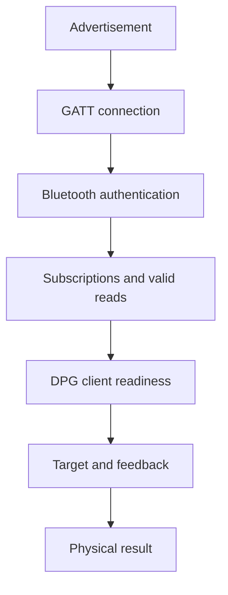
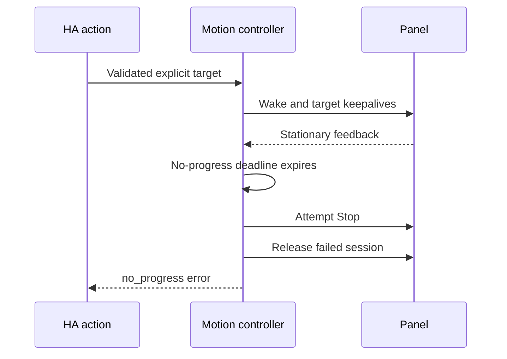

# Diagnose connection and movement failures

Use this manual to locate the failing layer before changing pairing, bounds or panel settings. A visible desk, a connected BLE client and a desk ready to move are different conditions. Start with the symptom table, then collect the evidence required for that branch.

## Optional settings validity

Downloaded diagnostics include `settings.memories` and `settings.reminders`, each with `valid`, `age_seconds` and `error`. Age measures time since the last successful group read in this process, not BLE latency or a persisted timestamp. `null` age means no successful read. The stable `invalid_response` reason means a completed matching reply could not be decoded; no backend payload or identifier is exposed.

During normal runtime refresh, a malformed memory/reminder response makes only that group's sensors unavailable while valid height/other groups remain available. A later validated reply restores the group. Old values may remain in memory for diagnosis but are not published as current settings or used to authorize movement. Initial setup and calibration verification still require complete replies. A timeout, disconnect, changed capabilities or invalid height reference can still make the whole session unavailable; those failures are never ignored. Reference/position checks run every 60 seconds; memories and reminders are each due five minutes after their last successful read. Invalid groups retry at the next check. Setup/calibration, reconnect and changed references force full reads. Notifications do not refresh a settings age or postpone the scheduled check. These intervals are read policy, not a measured claim about firmware load or OLED sleep.

## Choose the symptom

Find the closest symptom and collect the next missing evidence. The [shared glossary](README.md#terms-used-in-these-guides) explains the transport terms.

| Symptom | What is established | Next check |
| --- | --- | --- |
| IKEA ownership conflict | Another enabled `idasen_desk` entry claims the same normalized address | Disable that desk entry in IKEA Idasen Desk, then retry/reload LINAK; do not remove pairing or reset the panel |
| Desk is not discovered | HA has no usable discovery record | Panel pairing indication, HA Bluetooth advertisements and connectable adapter availability |
| Discovery works, connection times out | An advertisement was seen; no usable GATT session completed | `connection` stage, actual backend, competing desk clients and fresh advertisements |
| Pairing or subscription fails | Connection progressed beyond discovery | Authentication result and the specific subscription stage |
| Height reads work, movement does not | The read path works | Fresh bounds, client readiness, requested memory and movement failure reason |
| RSSI is available, controls are unavailable | A scanner still hears the desk | Connection/backend state; RSSI is not an active-link test |
| Entities become unavailable after an action | The session no longer supplies valid state | Determine whether radio loss caused the error or cleanup deliberately disconnected |
| Stored heights repeat or shift slots | Reply association may be wrong | Read-response ordering and the capabilities barriers between memory reads |
| Displayed height disagrees with a tape measure | The height reference may be wrong | Protected calibration; do not invent different measurements to satisfy bounds |

## Understand the layers

Each layer requires its own success evidence before the next operation can rely on it.

Success at one box does not establish success at the next. The panel's visible pairing message is not a machine-readable confirmation of all these layers.

## Collect a useful failure record

Capture one attempt with a known start time and expected outcome. Repeated retries without a changed condition make traces harder to interpret.

1. Record integration revision, HA version, host OS, panel model and known firmware/Full/Limited variant. Mark unknown values as unknown.
2. List the available Bluetooth paths and whether each supports active connections. Record the backend of the actual connected client when available.
3. Download diagnostics from the device page before and after the attempt. A first-onboarding failure has no entry or download; use its progress error and stage logs instead.
4. Record the action, configured bounds, current reported height and, for movement, the intended target or memory slot. Compare a height dispute against a tape measurement.
5. Keep the `ha_linak` stage transitions and first failure, including the events before any disconnect. Note whether the physical panel moved or stopped.
6. Redact identifiers before sharing the record. Keep raw radio/system-bus captures private.

Enable debug logging for `custom_components.ha_linak` when stage timing is needed. Lower-level Bleak/connector logs can expose names, addresses and raw application identifiers; use them only for a scoped capture and restore the previous logging level afterward. A Core log alone may not contain the Bluetooth controller's disconnect reason.

Stage durations measure time since entering the previous stage. `ready completed after 60s; entering extended_reads` includes the idle interval between scheduled checks; it is not a 60-second settings query. Read the subsequent operation durations and the first failure separately. Another device's connector messages are not LINAK retries: correlate the device privately before sharing redacted logs.

## Interpret the failed stage

The first failed operation determines the next investigation. Later cleanup errors do not replace that evidence.

| Stage/error | Interpretation | Required evidence or action |
| --- | --- | --- |
| Waiting for HA startup | Entry setup was deferred before HA reached running; no radio work attempted | HA retries on its started event; do not delete the entry |
| Setup retry after the initial connection/read deadline | A post-start attempt exceeded the 60-second refresh budget | HA retries the entry; inspect connection stages instead of restarting HA or deleting the entry |
| `device_lookup` | HA cannot supply a current connectable device | Inspect discovery freshness and connectable adapter support |
| `connection` / `timeout` | Connector did not finish establishing a usable link | Record backend/path and advertisement presence; do not diagnose offset or parsing |
| `pairing` / `pairing_agent_unavailable` | Local agent setup failed | Inspect BlueZ agent lifecycle; preserve existing bonds |
| `authentication_failed` | Backend rejected authentication | Distinguish host bond failure from DPG client status |
| `pairing_timeout` / `pairing_unsupported` | Authentication exceeded its budget or backend lacks the operation | Check the selected backend; do not silently bypass authentication |
| `notify_dpg` / `notify_height` | A specific subscription failed | Characteristic properties, authentication and actual disconnect event |
| `extended_reads` | A serialized DPG query failed validation or timed out | Command/response type and length, duplicates and barriers; never advance an ambiguous request |
| `position_read` | Fresh position could not be validated | Height characteristic and four-byte feedback frame |
| `movement_activation_check` / `movement_activation_write` | Foreground client readiness failed | Valid identity, application acknowledgement and unchanged-identifier readback |
| `movement_prepare` | Bounds, offset or selected slot cannot authorize movement | Current measured reference, configured range and exact slot read |
| `movement` / `stop` | Control loop or cleanup failed | Use the movement reason table below |

Calibration/preparation flows log a rejected setting's protocol status without raw payloads. Movement currently reports the `SettingRejected` exception class, so its warning alone does not expose the status byte. `0b` has been observed in scoped setting tests; its detailed vendor meaning is not established. A successful GATT write is not an application acknowledgement or a verified physical result.

## Interpret a movement failure

A warning records action, phase, reason and the backend captured before cleanup. The reason describes what the software detected, not necessarily the underlying hardware cause.

| Reason | Detected condition | Investigation |
| --- | --- | --- |
| `no_progress` | Position did not advance toward the target before the stall deadline | Check client readiness, feedback and command cadence; do not extend deadlines blindly |
| `reverse_motion` | Retreat from the best position exceeded tolerance | Stop the test; compare direction and raw target conversion |
| `overshoot` | Feedback passed the target beyond tolerance | Compare raw feedback and target; do not treat the requested target as measured height |
| `outside_limits` | Feedback is outside configured relative bounds | Verify calibration and real bounds before another command |
| `link_lost` | The transport was disconnected during movement | Capture the actual link-loss event and backend evidence |
| `stop_failed` | Stop could not complete on the session | Use physical stopping and investigate transport/cleanup |
| `unknown` | A movement/preflight error has no dedicated guard code | Use its phase, connection state and request validity; no raw exception message is exposed |
| Exception class, such as `TimeoutError` | Transport, deadline or validation failed outside a named motion guard | Use phase and preceding events; raw backend messages are intentionally omitted |

Movement failures and ambiguous cleanup discard the session. A successful explicit Stop during the target loop retains a ready link, even though the interrupted target reports an action error. A subsequent `Connection: Disconnected` therefore cannot prove that radio loss caused the original failure.

That sequence was observed on local BlueZ. In a separate bounded experiment, activating the existing client preceded nonzero speed feedback. Complete target arrival remains unverified; see [hardware evidence](hardware-results.md#client-readiness-and-movement).

## Diagnose multiple adapters without guessing

HA selects an active connection path using signal and available slots. After a successful connection, a debug line records `BLE session connected: backend=...` using the same category as the optional backend sensor. Failed attempts may not yet have a selected client backend; use the backend library's preceding connection trace instead. A nearby adapter is not proof of the selected path, and the RSSI sensor can use an advertisement heard by another scanner.

HA also penalizes paths with previous failures. A strong advertisement does not prove that its adapter can establish a connection. The connector can retry another path within the same bounded LINAK refresh; LINAK does not pin an adapter or clear HA's failure counters. This permits fallback but cannot guarantee an immediate connection or fix a peripheral that is not accepting connections. See the [local/proxy comparison](hardware-results.md#local-and-proxy-connection-establishment) for the observed distinction.

| Evidence | What it can establish | What it cannot establish |
| --- | --- | --- |
| Backend `bluez_dbus` | The client uses local BlueZ | Which local adapter if more than one exists |
| Backend `bleak_esphome` | The backend identifies an ESPHome transport | Its room, radio quality or firmware correctness |
| Backend `other` | A connected backend outside the allowlist or a generic wrapper | A guessed proxy brand |
| Better behavior after disabling a proxy | The environment changed | That the proxy caused every previous failure |
| Stable reads followed by a motion guard | Read path worked until the action | Why the controller did not move |

For an agreed comparison, keep the desk, integration revision and requested operation constant. Test local-only, proxy-only and mixed paths, record the actual backend and restore the original configuration afterward. Do not turn adapter isolation into a permanent installation requirement. The [HA Bluetooth documentation](https://www.home-assistant.io/integrations/bluetooth/) explains path selection and proxy support.

## Diagnostic entities and download fields

Diagnostic entities describe transport or conversion state. Height, stored heights and reminder profiles remain ordinary sensors.

| Entity | Default | Source and limitation |
| --- | --- | --- |
| Connection | Enabled | Ready connected client; reports off after failure even when ordinary readings become unavailable |
| Bluetooth signal strength | Disabled | Latest connectable advertisement RSSI in dBm; not active-link RSSI or an adapter identifier |
| Bluetooth backend | Disabled | Allowlisted category of the active client; unavailable without a connection |
| Height offset | Enabled | Technical conversion reference; editing belongs to protected calibration |

Enable optional diagnostics through **Settings → Devices & services → Entities**, including disabled LINAK entities in the filter. Enabling them does not change panel settings. RSSI reads HA's cache and checks presence every 60 seconds while enabled; it adds no scan or GATT request. A quiet connected desk may have unavailable RSSI.

| Download field | Meaning |
| --- | --- |
| `connected`, `stage`, `last_update_success` | Client readiness, last phase and shared-read availability |
| `bluetooth.signal_strength`, `bluetooth.signal_strength_source` | Cached RSSI with explicit `advertisement` source; not active-link RSSI |
| `bluetooth.backend` | Allowlisted active connection backend category |
| `controls.range_configured`, `controls.busy` | Whether usable bounds exist and a foreground operation owns the client |
| `controls.last_result` | Software result: `not_requested`, `moving`, `completed`, `interrupted`, `failed`, `stop_sent` or `stop_failed` |
| `state` | Raw decoded position, reference, capabilities, memories and reminders |

`completed` and `stop_sent` are software outcomes, not independent physical verification. Normal sensor/history presentation rounds heights; raw diagnostic state retains precision.

## Privacy and recovery

Downloaded integration diagnostics omit desk names, Bluetooth addresses, adapter identifiers and client identity bytes. Local device registries still contain name/address metadata; separate identity sensors are unnecessary. Screenshots and upstream debug logs need manual redaction.

After a failed test, establish physical stopping first, end the diagnostic client and restore the intended integration/adapter configuration. Verify fresh reads before another action. Do not reset the panel, remove bonds, replace client identifiers or replay uncertain writes as routine troubleshooting. Use the [investigation method](bluetooth-research.md) when the evidence does not yet support a repair.

A `DPG read timed out: command=...` debug message identifies the allowlisted read that expired. Runtime refresh errors include a stage and stable exception/reason category. Neither message includes the raw backend exception, desk name or address. Backend categorization accepts known public identifiers and, when an HA wrapper reports a generic identifier such as `type`, recognizes only allowlisted implementation modules; unknown implementations remain `other`. This improves diagnosis without pinning an adapter or changing HA selection.
