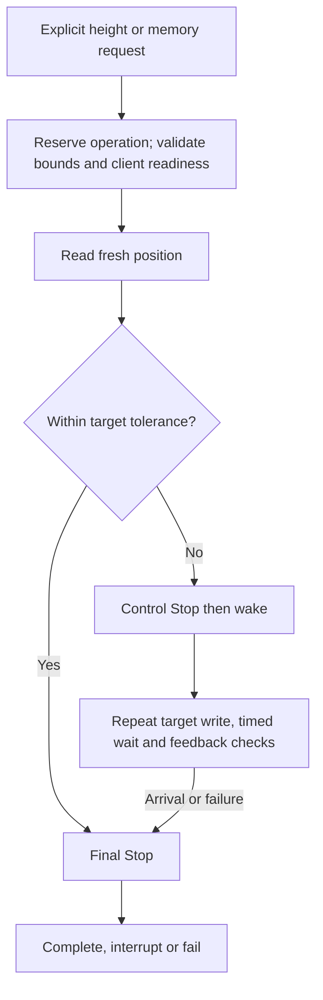
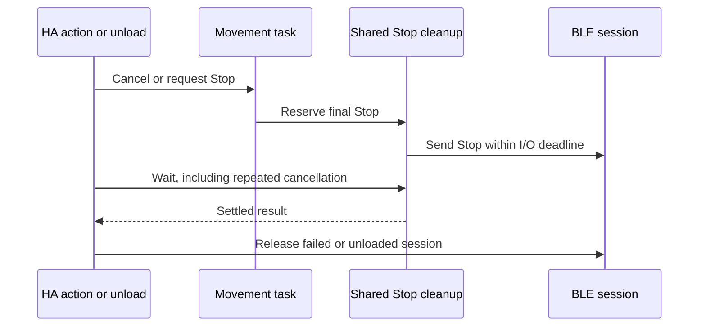
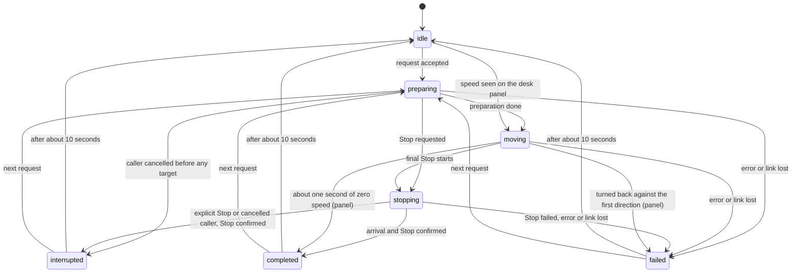

# How desk movement is prepared, monitored and stopped

Both the native height slider and stored-position buttons use one movement controller. It operates on the existing connected client, validates centimeter conversion and monitors measured feedback. This reference defines the software behavior; the [control guide](controls.md) defines supervised owner testing.

## Control path

Preparation checks the live offset and selected memory under exclusive ownership. It rejects invalid bounds, an empty slot or an out-of-range target before activation or motion. Inactive clients receive one protected activation using the unchanged identifier, followed by status/identifier verification. An already active client receives no activation write.

Polling, connection establishment and idle Stop never activate a client. Foreground activation does not change the height reference, stored positions, reminders or firmware limits. See [protected setting exchanges](protocol.md#protected-setting-exchanges).

## Conversion and target selection

The controller uses the live panel reference to convert the requested height into a relative mechanism position.

| Input | Conversion | Constraint |
| --- | --- | --- |
| Slider height in cm | `round(height_cm * 100 - offset_raw)` | Must be within configured relative bounds |
| Stored position | Read exact selected raw position, then add the live offset for the common controller | Empty/out-of-range slots cannot move |
| Lower/upper command bounds | Measured centimeter bounds minus the panel offset | Host-side constraints, not discovered or programmed mechanical limits |
| Actual height | `(position_raw + offset_raw) / 100` | Publish device feedback, never the requested target as fact |

The slider's integer presentation is separate from wire precision. Saved-position movement uses exact raw values, and no target is stored for replay after reload or reconnect.

## Command loop and budgets

The current sequence sends control Stop, then wake, then repeated target writes. Each iteration waits before a fresh position read. Target transmission and reading are serialized, so the effective target interval also includes transport/read latency.

| Constant | Value | Meaning |
| --- | --- | --- |
| `COMMAND_INTERVAL` | 0.2 seconds | Wait within each target/read iteration; not a guaranteed end-to-end packet interval |
| `IO_TIMEOUT` | 1 second | Shared deadline for each control/target write or the two-frame Stop |
| `READ_TIMEOUT` | 3 seconds | Position-read deadline; does not extend the Stop/write deadline |
| `STALL_TIMEOUT` | 2 seconds | Maximum interval without a new best position toward the target |
| `MOVE_TIMEOUT` | 30 seconds | Target/feedback-loop deadline, excluding preparation and final cleanup |
| `TOLERANCE_RAW` | 10 raw units, or 1 mm | Arrival/reversal threshold; not a physical positioning-accuracy claim |

Preparation uses the DPG exchange budgets in the [connection reference](onboarding.md#session-lifetime-and-deadlines); there is no single 30-second budget for preparation plus travel plus cleanup.

A target inside arrival tolerance sends final Stop without wake or target packets. Otherwise the controller tracks directional progress against the best position reached. A new best position resets the stall timer; reverse movement, returning to the same best or small jitter does not.

| Guard | Abort condition |
| --- | --- |
| Link state | Transport disconnected |
| Bounds | Current feedback outside measured relative limits |
| Direction | Cumulative retreat from the best position exceeds tolerance |
| Overshoot | Feedback passes the target beyond tolerance |
| Progress | No new best position before the stall deadline |
| Deadlines | Individual I/O or complete movement budget expires |

Every exit attempts both control Stop and reference-input release. A failed motion session is discarded rather than reused for another queued target. A successful explicit Stop during the target loop retains the ready link; the next action is a new request, never a replay. The [diagnostic reason table](diagnostics.md#interpret-a-movement-failure) distinguishes these failures without exposing raw backend messages.

## Competing requests

One operation owns the client from preparation through final cleanup. New slider or stored-position requests are rejected immediately while that reservation or a settings exchange is active. The busy response asks the user to wait or press Stop; it does not schedule a later move or send another packet. Choosing a new target requires a fresh request after the current operation settles.

The HA action reports this refusal as `ServiceValidationError` with the translated `control_busy` message. The frontend receives `service_validation_error`, rather than the `home_assistant_error` used for device/transport failures. The original operation keeps its goal and result; rejecting another request does not mark the active movement failed, and the [operation status](#operation-status) keeps showing that operation. The rejected action remains unsuccessful for automations and scripts, so they cannot mistake it for an executed command. HA 2026.10.4 also logs frontend validation refusals at `ERROR`; severity alone does not identify a failed BLE session.

| Input during an active operation | Result | Additional target writes |
| --- | --- | --- |
| Slider or stored-position button, including repeats | Busy response; original goal continues | None from the rejected request |
| Stop during movement | Cancel goal and await bounded Stop/release | No replacement target |
| Repeated Stop while cleanup runs | Join the existing Stop task | None; share the same cleanup |
| New target while Stop runs | Busy response until cleanup settles | None |
| New target after successful Stop | Validate and execute a new explicit operation | Normal bounded command loop |
| Stop cleanup failure | Surface the error and discard the session | No queued or resumed target |

This admission policy bounds concurrent work; it is not a firmware overload or electrical safety certification. The normal target keepalive cadence and feedback guards still apply. There is no automatic retargeting, delayed queue or command replay.

## Stop, cancellation and unload

Stop has a separate shared task so it can preempt movement without waiting for the polling lock. If it interrupts preparation before the movement controller exists, the client attempts one bounded Stop on the still-connected link before discarding the preparation session. Failure or timeout remains visible to the Stop caller; no wake or target is sent. When idle, it sends control Stop and reference-input release, without activation, wake or a height target. An explicit interruption whose final Stop and reference release succeed completes the HA action without an error. A failed cleanup still fails both the movement and Stop actions.

Movement completion, explicit Stop and close/unload retain ownership until their cleanup settles. Shielding prevents repeated caller cancellation from cancelling the final Stop packet. Late errors are observed and propagated. A Stop timeout closes/discards the session; it does not silently report successful stopping.

Software can confirm that the transport call returned, not that the physical desk stopped. Radio loss can prevent Stop delivery. Initial hardware tests therefore require physical stopping access and direct observation.

## Operation status

The `Operation` sensor reports the explicit request that owns the client and, afterwards, how it ended. It is software state: it names the request and its cleanup, and it is not evidence that the desk reached the height or stopped. A movement started on the desk panel is observed from height feedback and reported with `source: panel`; it has no requested height and no Stop of its own. Measured height, the settled slider value and the Bluetooth connection keep their own entities, and the sensor never records feedback ticks.

| State | Meaning |
| --- | --- |
| `idle` | No operation is running. It is the state before the first request and again about 10 seconds after a result, so a notification can trigger on the result and the status then rests at idle |
| `preparing` | The request owns the client while the reference, the selected slot and client readiness are checked |
| `moving` | The command loop sends targets and checks feedback |
| `stopping` | Final control Stop and reference release are running, after arrival, a guard failure, an error or an explicit Stop |
| `completed` | The target was reached within tolerance and the final Stop was confirmed |
| `interrupted` | An explicit Stop or a cancelled calling action ended the request, and its Stop and release were confirmed or no target had been sent yet |
| `failed` | The request ended without a confirmed result; the `reason` attribute names what the software detected |

| Situation | Status |
| --- | --- |
| A competing request is refused with `control_busy` | Unchanged: the active operation and the last result stay as they were |
| Stop while no operation is active | Unchanged; a failed Stop records `failed` with reason `stop_failed` |
| Stop during preparation, travel or final cleanup | `stopping`, then `interrupted` once Stop and release are confirmed, never `completed` |
| Stop before the accepted request has started | The request waits for that Stop and settles with its outcome: `interrupted` when the Stop was delivered, `failed` with `stop_failed` when it was not |
| Stop after the movement ended but before the request settled | The movement's own result stands, because it already finished with its confirmed final Stop, so a completed move stays `completed`; a Stop that fails there makes the result `failed` with `stop_failed` |
| The calling action is cancelled | `interrupted` once the final Stop is delivered, or at once when no target was sent yet; `failed` with `stop_failed` when the Stop could not be confirmed |
| The transport is lost during an operation | `failed` with `link_lost` at once; later cleanup errors do not rewrite it |
| Reconnect | A settled result stays for its short pause and then rests as the last result; nothing resumes the old goal |
| Reload or Home Assistant restart | Starts at `idle`; no result or goal is stored, so the last result is empty |
| Calibration | Not an operation; setup and options flows report their own progress |

The `requested_height_cm` attribute holds the requested goal, never a measurement.

- A target request records it when accepted. A stored-position request records it once the selected slot has been read.
- While the status rests at idle after a result, `last_result`, `last_requested_height_cm` and `last_reason` keep that result, so the reason of a failure is not lost.
- Those attributes are held in memory only and disappear after a reload or restart.
- The sensor stays available when the connection drops, so a failed result keeps its reason visible.
- A refusal can also come from a read in progress, because the client serves one exchange at a time. The status then stays as it was.

The reason codes are listed in the [diagnostic manual](diagnostics.md#interpret-a-movement-failure).

## Protocol differences still under investigation

The inspected upstream `idasen` implementation uses different wake/Stop ordering. This integration now uses its two-channel Stop contract while retaining the existing initial ordering. Physical-panel gesture recovery, target cadence under proxy latency and firmware-specific behavior still need separate observations. See the [library comparison](communication-review.md#movement-contract-differences).

## Validation boundary

Automated tests cover conversion, readiness, target ordering, guards, cancellation, repeated cleanup cancellation and ownership with simulated Bluetooth. Hardware evidence includes stationary failed target feedback and a bounded activation/movement attempt interrupted by timed Stop. Complete arrival, physical stopping accuracy, downward travel and mixed-adapter behavior remain unverified. Follow [native HA testing](controls.md#test-native-controls-at-the-panel) before unattended use.
