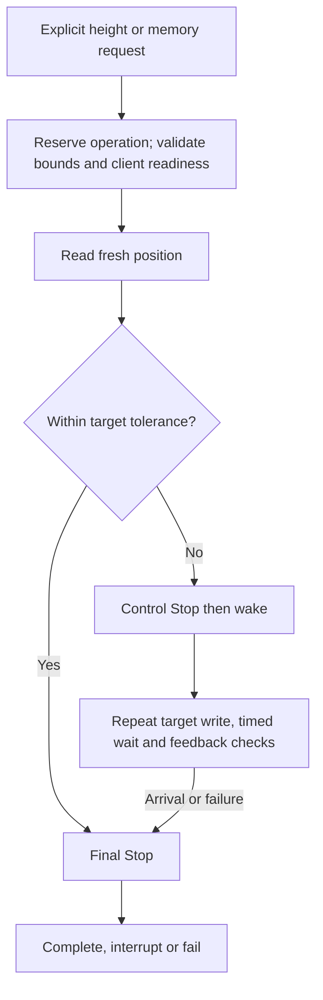
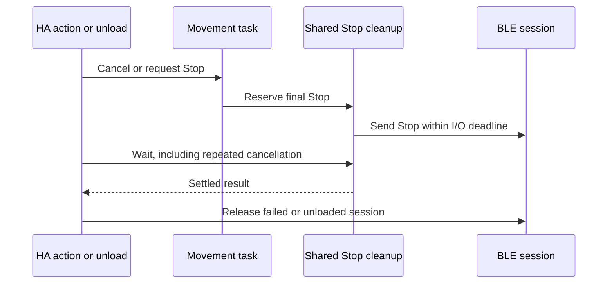

# How desk movement is prepared, monitored and stopped

Both the native height slider and stored-position buttons use one movement controller. It operates on the existing connected client, validates centimeter conversion and monitors measured feedback. This reference defines the software behavior; the [control guide](controls.md) defines supervised owner testing.

## Control path

Preparation checks the live offset and selected memory under exclusive ownership. It rejects invalid bounds, an empty slot or an out-of-range target before activation or motion. Inactive clients receive one protected activation using the unchanged identifier, followed by status/identifier verification. An already active client receives no activation write.

Polling, connection establishment and idle Stop never activate a client. Foreground activation does not change the height reference, stored positions, reminders or firmware limits. See [protected setting exchanges](protocol.md#protected-setting-exchanges).

## Conversion and target selection

The controller uses the live panel reference to convert the requested height into a relative mechanism position.

| Input | Conversion | Constraint |
| --- | --- | --- |
| Slider height in cm | `round(height_cm * 100 - offset_raw)` | Must be within configured relative bounds |
| Stored position | Read exact selected raw position, then add the live offset for the common controller | Empty/out-of-range slots cannot move |
| Lower/upper command bounds | Measured centimeter bounds minus the panel offset | Host-side constraints, not discovered or programmed mechanical limits |
| Actual height | `(position_raw + offset_raw) / 100` | Publish device feedback, never the requested target as fact |

The slider's integer presentation is separate from wire precision. Saved-position movement uses exact raw values, and no target is stored for replay after reload or reconnect.

## Command loop and budgets

The current sequence sends control Stop, then wake, then repeated target writes. Each iteration waits before a fresh position read. Target transmission and reading are serialized, so the effective target interval also includes transport/read latency.

| Constant | Value | Meaning |
| --- | --- | --- |
| `COMMAND_INTERVAL` | 0.2 seconds | Wait within each target/read iteration; not a guaranteed end-to-end packet interval |
| `IO_TIMEOUT` | 1 second | Deadline for each motion I/O operation |
| `STALL_TIMEOUT` | 2 seconds | Maximum interval without a new best position toward the target |
| `MOVE_TIMEOUT` | 30 seconds | Target/feedback-loop deadline, excluding preparation and final cleanup |
| `TOLERANCE_RAW` | 10 raw units, or 1 mm | Arrival/reversal threshold; not a physical positioning-accuracy claim |

Preparation uses the DPG exchange budgets in the [connection reference](onboarding.md#session-lifetime-and-deadlines); there is no single 30-second budget for preparation plus travel plus cleanup.

A target inside arrival tolerance sends final Stop without wake or target packets. Otherwise the controller tracks directional progress against the best position reached. A new best position resets the stall timer; reverse movement, returning to the same best or small jitter does not.

| Guard | Abort condition |
| --- | --- |
| Link state | Transport disconnected |
| Bounds | Current feedback outside measured relative limits |
| Direction | Cumulative retreat from the best position exceeds tolerance |
| Overshoot | Feedback passes the target beyond tolerance |
| Progress | No new best position before the stall deadline |
| Deadlines | Individual I/O or complete movement budget expires |

Every exit attempts Stop. A failed motion session is discarded rather than reused for another queued target. The [diagnostic reason table](diagnostics.md#interpret-a-movement-failure) distinguishes these failures without exposing raw backend messages.

## Stop, cancellation and unload

Stop has a separate shared task so it can preempt movement without waiting for the polling lock. If it interrupts preparation before the movement controller exists, the client attempts one bounded Stop on the still-connected link before discarding the session. Failure or timeout remains visible to the Stop caller; no wake or target is sent. When idle, it sends Stop only, without activation, wake or target writes. An interrupted target may report an action failure even when Stop succeeds.

Movement completion, explicit Stop and close/unload retain ownership until their cleanup settles. Shielding prevents repeated caller cancellation from cancelling the final Stop packet. Late errors are observed and propagated. A Stop timeout closes/discards the session; it does not silently report successful stopping.

Software can confirm that the transport call returned, not that the physical desk stopped. Radio loss can prevent Stop delivery. Initial hardware tests therefore require physical stopping access and direct observation.

## Protocol differences still under investigation

The inspected upstream `idasen` implementation uses different wake/Stop ordering and an additional reference-input Stop payload. The current controller does not copy those differences automatically. Their effect, target cadence under proxy latency and firmware-specific behavior require separately scoped experiments. See the [library comparison](communication-review.md#movement-contract-differences).

## Validation boundary

Automated tests cover conversion, readiness, target ordering, guards, cancellation, repeated cleanup cancellation and ownership with simulated Bluetooth. Hardware evidence includes stationary failed target feedback and a bounded activation/movement attempt interrupted by timed Stop. Complete arrival, physical stopping accuracy, downward travel and mixed-adapter behavior remain unverified. Follow [native HA testing](controls.md#test-native-controls-at-the-panel) before unattended use.
