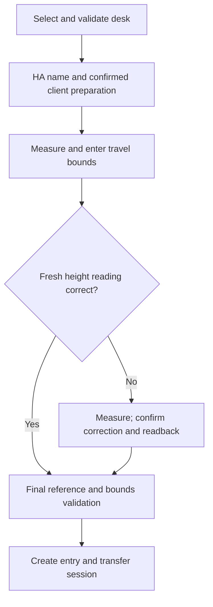
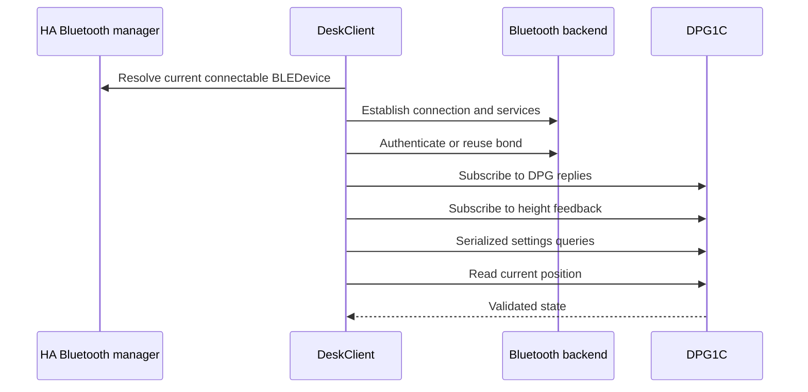

# Connect and configure a desk

This reference explains the configuration flow and connection lifecycle. Use the [control guide](controls.md) for owner-facing configuration steps and the [diagnostic manual](diagnostics.md) when a step fails. Discovery, Bluetooth authentication and DPG client activation are separate stages.

## One integration per desk

Before connecting, preparing the client, confirming calibration or handing a completed wizard session to runtime, LINAK checks for an enabled `idasen_desk` entry with the same normalized Bluetooth address. The official HA 2026.10.4 integration stores that address in `data.address`; a missing/invalid data address falls back to the entry's unique ID. Colons, hyphens, compact hexadecimal and dotted MAC forms compare consistently. Disabled or ignored entries and other desks do not block setup. An enabled entry still counts if its own setup failed, because it can retry.

If the conflict message appears, open **Settings → Devices & services → IKEA Idasen Desk**, disable the entry for this desk, then retry LINAK. Disabling keeps the IKEA configuration. LINAK never disables, deletes, renames or changes that entry. Keeping IKEA enabled instead is also possible: leave the LINAK entry disabled.

Loaded LINAK entries recheck ownership on each scheduled idle refresh and before a new movement or calibration. An idle refresh detecting conflict releases LINAK's own connection and reports unavailable; normal refresh/retry can recover after IKEA is disabled. Stop remains available for an already owned connection, and an operation already in progress keeps its cleanup ownership. This is a check of configured entries, not a Bluetooth-wide lock: it cannot arbitrate an unfinished IKEA wizard, external apps or an IKEA enable that races an operation already underway. It does not interrupt an ongoing move automatically or introduce a registry watcher.

## Setup sequence

The wizard validates the desk before creating an entry and keeps the same connection across foreground steps.

| Step | Information or action | Result |
| --- | --- | --- |
| Selection | Choose an HA-discovered connectable device | Reserve its unique address; reject duplicates |
| Validation | Connect, pair when needed, subscribe, read settings and position | Show progress and a stage-specific failure if validation fails |
| Name/preparation | Choose a name in HA and confirm panel preparation | Preserve the client identifier; skip an already active client |
| Range | Enter measured minimum and maximum desktop heights | Store proposed host-side command bounds; do not move or program firmware limits |
| Height check | Refresh the reading after measuring the range | Use a current stationary baseline for any correction |
| Correction | Enter current tape measurement and review a separate confirmation | Write once, verify the reference and refresh dependent heights |
| Final validation | Re-read on the height-correct path or use verified calibration results | Save only bounds compatible with the current reference and position |
| Entry creation | Transfer the validated session to runtime | Load entities without an unnecessary reconnect |

An unchanged height correction sends no offset write. Calibration inputs are transient and are not replayed after restart. Failed preparation returns to its form instead of silently creating an unprepared entry.

## Discovery names and identity

The discovery card uses a desk name and short address suffix, such as `Office desk (EEFF)`. Resolution checks current HA metadata, the original discovery record and BLE device names. Generic `LINAK` and address-only values do not hide a usable name.

On Linux, a two-second cached BlueZ metadata lookup can improve a fallback name without connecting or scanning. After authentication, an optional readable GAP Device Name characteristic can supply a name. Missing, denied or malformed names retain the fallback; transport failures still invalidate the attempt.

The name entered in the wizard belongs to HA, not the Bluetooth panel. Explicit HA names take priority on reload. Older address-only titles can be repaired; an existing title exactly `LINAK` is not automatically assumed to be integration-owned. Device-registry user names remain intact.

## Connection and authentication

Each new transport follows the same read-only establishment sequence:

| Backend | Authentication behavior | Boundary |
| --- | --- | --- |
| Local BlueZ | Reuse `Paired`; otherwise register a private `NoInputNoOutput` Agent1 and call Device1.Pair on the same bus | Resolve one connected Device1 matching the selected address; fail on missing/ambiguous matches |
| CoreBluetooth | Let macOS manage protected-characteristic authentication | Do not call unsupported explicit pairing |
| ESPHome/other supported backends | Use the backend pair operation | Unsupported pairing is reported, not bypassed |

BlueZ associates an application agent with its caller's bus identity. Registering an agent on one bus and pairing through another can leave confirmation unavailable. The private agent handles only the selected device, rejects unrelated requests and does not request default-agent status. Closing its bus removes it on completion, failure or cancellation. It does not set `Trusted`, replace bonds or alter adapter scan mode.

Connection establishment does not activate the DPG application client. Setup preparation and explicit control use the separate [activation contract](protocol.md#protected-setting-exchanges).

## Session lifetime and deadlines

The connector receives a device callback so retries can use current HA adapter metadata. HA reevaluates connection paths on each retry, including their previous failures and available slots. LINAK uses the installed connector's retry policy rather than stopping after two failures: a stronger local path can fail twice before HA prefers a working proxy. All retries and subsequent validation still share one 60-second refresh deadline. The deadline can interrupt the connector before its default retry count is reached; it does not grant each retry a new budget. One progress task owns each attempt; revisiting a progress step does not start a second connection.

| Boundary | Budget or behavior |
| --- | --- |
| Config-entry setup before HA reaches running | No radio work; HA retries on its started event |
| First connection/read after HA reaches running | 60 seconds, then bounded cleanup and HA-managed setup retry |
| Foreground wizard or later runtime read/connection attempt | 60 seconds |
| Pairing phase | 30 seconds inside the complete attempt |
| Individual ordinary I/O | 10 seconds, bounded by the outer attempt |
| DPG read/setting exchange | 8 seconds, bounded by its owning operation |
| Failed-link cleanup | Bounded disconnect cleanup; may add up to 10 seconds |
| Foreground setup idle time | Release after 300 seconds without a Bluetooth operation |
| Unconsumed setup-to-runtime transfer | Release after 60 seconds or HA shutdown |
| Abort | Cancel the progress task and drain owned cleanup |

Before HA is running, entry setup raises `ConfigEntryNotReady` without creating a client. HA schedules another setup attempt on `HOMEASSISTANT_STARTED`; unloading the waiting entry removes that retry. After startup, connection and reads share the 60-second refresh budget, with up to 10 seconds of cleanup. This permits the connector's own 20-second attempts and subsequent validation without blocking HA bootstrap. A failed attempt then uses HA's normal retry policy. Entities are forwarded only after a successful read; a transferred setup session is validated without forcing a reconnect. An entry whose Keep connected intent is off skips this first read entirely: it loads without waiting for the desk or for discovery, releases a session still held by the wizard and connects only when the owner turns the switch on (see [deliberate connection ownership](architecture.md#deliberate-connection-ownership)).

An expired idle session can be reopened when the wizard continues. Each new operation must validate fresh state. A failed preparation connection does not immediately launch another automatic read-only connection attempt. After a calibration failure beyond connection establishment, one read-only recovery may refresh the form without replaying the uncertain setting write.

Expected failures log a sanitized stage and error code. A connector `BleakNotFoundError` caused by exhausted timeouts remains a timeout, not a decode failure. Authentication failure, unavailable pairing agent, pairing timeout and unsupported pairing have distinct translated errors. See the [error table](diagnostics.md#interpret-the-failed-stage).

## Changes after installation

Configure provides focused paths for HA name, connection preparation, height correction and range. Renaming updates HA registries without reloading or reconnecting the desk.

Height correction is available before bounds exist. After verified correction, the flow requests missing bounds or revised bounds if the new reference invalidates them. This prevents a wrong panel offset from blocking the first valid range. Configure hides cached height when the latest update failed; it does not present old readings as a measurement baseline.

Changing physical devices or Bluetooth identity is not a general reconfigure workflow yet. Do not make delete/re-add, bond removal or panel reset the routine recovery path.

## Implementation and validation references

The implementation follows these HA contracts; the evidence register defines the tested hardware scope.

- [HA config flows](https://contributors.home-assistant.io/core/integrations/config-flow/)
- [HA progress steps](https://contributors.home-assistant.io/core/integrations/flow-steps/#show-progress)
- [HA Bluetooth integration APIs](https://contributors.home-assistant.io/core/integrations/bluetooth/)
- [Hardware evidence and unverified environments](hardware-results.md)
