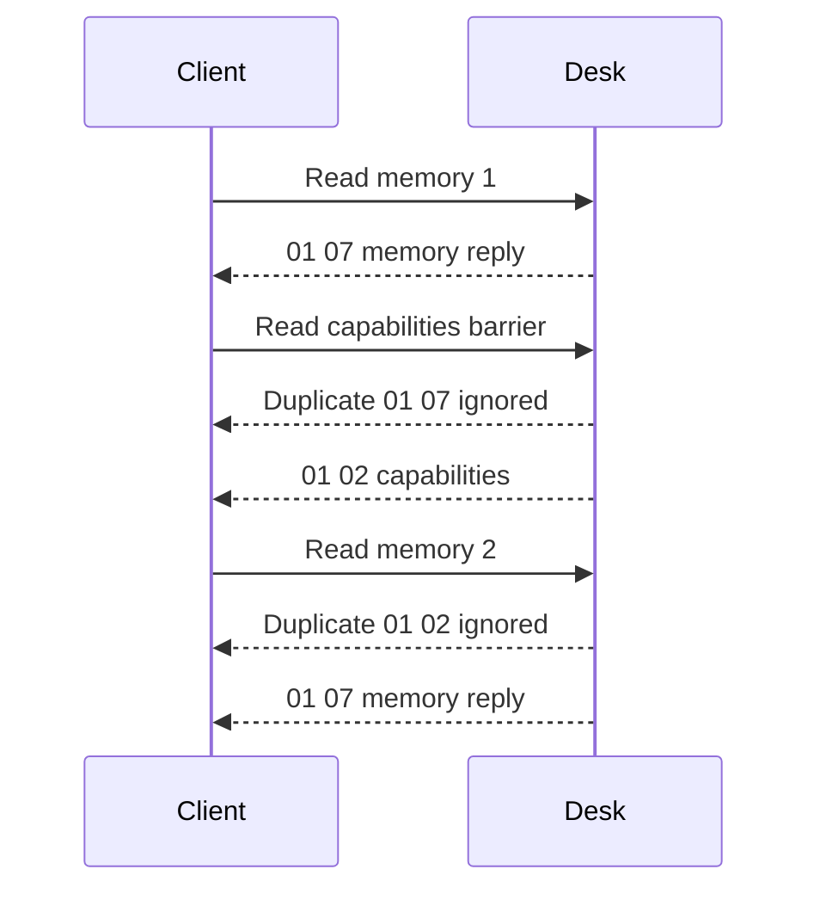
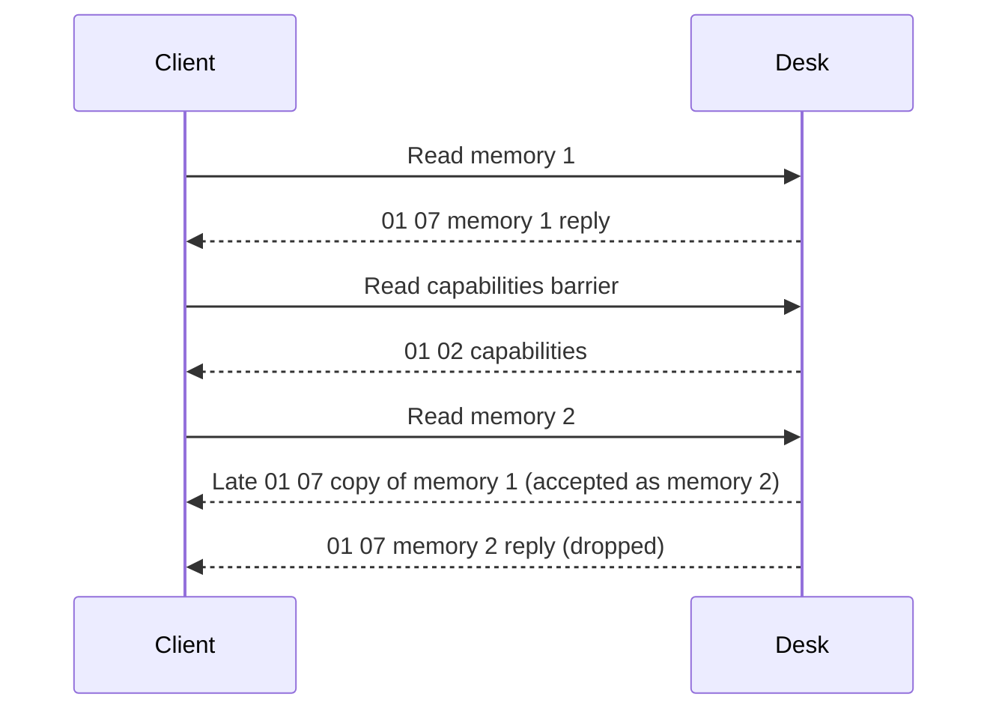

# DPG protocol reference

This reference describes the frames accepted by this integration and the evidence behind their interpretation. LINAK product manuals explain panel features, but no complete public GATT command specification was obtained. Community protocol definitions and one-panel observations do not establish compatibility with every firmware/OEM variant.

## GATT channels

Proprietary UUIDs below use suffix `-338a-1024-8a49-009c0215f78a`.

| UUID prefix or standard UUID | Role | Operation used |
| --- | --- | --- |
| `99fa0001` | Advertised desk service | Discovery |
| `99fa0002` | Control channel | Write without response for Stop/wake |
| `99fa0011` | Extended DPG commands and replies | Write with response plus notifications |
| `99fa0021` | Position/speed-word feedback | Read plus notifications |
| `99fa0031` | Relative target input | Write without response |
| `00002a00-0000-1000-8000-00805f9b34fb` | GAP Device Name | Optional read after authentication |

Reading `99fa0011` directly is not an extended-configuration query. Subscribe to notifications, send one allowlisted request and validate its reply. Motion characteristics must expose the required write operation; do not guess a write mode for missing properties.

## Position units and height reference

Height feedback contains exactly four bytes: little-endian unsigned `position_raw`, followed by the preserved raw speed word. Position uses 0.1 mm units, or 100 raw units per centimeter.

```text
height_cm = (position_raw + offset_raw) / 100
relative_target_raw = round(target_cm * 100 - offset_raw)
```

The offset is the panel's height reference. It is not a turbo-start position, firmware travel limit or a fixed IKEA datum. The decoder preserves the speed word without claiming verified direction/flags/units; nonzero speed is not an independently calibrated velocity sensor.

For a synthetic example, `position_raw = 1400` and `offset_raw = 6200` give `76.00 cm`. Correcting the reference changes converted heights, including displayed stored heights, without changing their raw mechanism positions.

## Extended reads

A read request is `7f <command> 00`. The DPG notification carries a response header and payload; byte counts below include the header. Only one query may be pending.

| Command | Meaning | Response header | Bytes | Decoded fields |
| --- | --- | --- | --- | --- |
| `80` | Capabilities | `01 02` | 4 | Capability flags and reference mask |
| `81` | Height offset | `01 03` | 5 | Validity byte and LE uint16 offset |
| `86` | Client identity/status | `01 11` | 19 | Status byte and 16 identifier bytes |
| `88` | Reminder configuration | `01 0b` | 13 | Flags, three sitting/standing pairs and raw counter |
| `89`–`8c` | Stored positions 1–4 | `01 07` | 9 when valid; 7 when empty | Validity, optional LE uint16 position and raw counter |

The capability flags expose a slot count in bits 0–2 and automatic-up, automatic-down, Bluetooth, display and light flags in successive bits. The implementation rejects unsupported slot counts above four. Capability flags are not setting values or proof that motion works on the current client.

Reminder durations are configuration values in minutes under the current interpretation, not elapsed sitting/standing counters. Unknown flags and counters remain raw. Do not label them as occupancy, lifetime cycles, uptime or calories.

## Correlate replies and reject ambiguity

Reply type and length must match the pending command. A successful GATT write alone does not establish that the query completed. A timeout or lost link invalidates the session instead of advancing to the next request. A malformed reply of the pending type does the same for required reads and foreground setup; during a runtime refresh it invalidates only its optional group, as listed [below](#failure-handling-by-event).

All memory slots use response type `07` without a slot number. Duplicate signals can therefore be misassigned if consecutive slot requests have no intervening response type.



The client compares each barrier's capabilities with the initial snapshot. A change invalidates the refresh. An ordered stream of duplicates is filtered by response type; equal saved positions remain valid and are not deduplicated by value. Four memories add three capabilities barriers. This does not solve arbitrary out-of-order transport delivery or establish why BlueZ multiplied signals in the observed capture. The next subsections state which late frames the barrier absorbs and which it cannot.

### Stale and duplicate frames

A frame is accepted only while a request with the same response type is pending on the current connection. The table lists every state in which a stale or duplicate frame can arrive and the resulting behavior.

| Client state when the frame arrives | Outcome | Reason |
| --- | --- | --- |
| The pending request already has its reply, as with the rest of a duplicate burst | Ignored | A request accepts one reply |
| A request with a different response type is pending, such as a barrier, the offset or the reminders | Ignored | Reply type must match |
| No request is pending, as during the final height read | Ignored | Nothing is waiting |
| A request with the same response type is pending | Accepted as its reply | Type is the only correlation the wire provides |
| The frame comes from a closed connection | Ignored, nothing published | Callbacks carry their connection generation, which cleanup and reconnect advance |

A complete refresh sends `80 81 89 80 8a 80 8b 80 8c 88`, with response types `02 03 07 02 07 02 07 02 07 0b`. No two consecutive requests share a type, so a copy of the previous reply meets a request of a different type, as in the second row. The fourth row, a late copy that meets a request of its own type, is the limit described next.

### The case a barrier cannot detect

A type `07` copy that arrives while the next slot's request is pending is accepted as that slot's reply. The genuine reply is then dropped, the session stays ready and nothing on the wire reveals the mix-up. When the genuine slot is empty, a populated stale frame makes it appear populated. The barrier protects an ordered stream, in which every copy arrives before the barrier reply. It cannot protect against a copy that crosses it. Whether a copy crosses the barrier on a real stack is not established; the test that would decide it is listed in the [investigation guide](bluetooth-research.md#next-tests-that-can-change-a-conclusion). Saved-position movement rereads the selected slot behind an offset read under exclusive ownership. That single read has the same type-only identity, and the configured bounds still apply.



### Failure handling by event

The client discards the connection instead of guessing whenever request and reply assignment becomes uncertain. It degrades only an optional group when a completed reply of the right type fails decoding.

| Event | Connection | Optional groups | Caller sees |
| --- | --- | --- | --- |
| Timeout of any query or of the final height read | Discarded; its callbacks are dropped | All invalid until a complete reread | `TimeoutError` |
| Link lost while a request is pending, or in the same loop turn as its reply | Discarded, even if the reply arrived first | All invalid | `DeskLinkLost` |
| Malformed capabilities, offset or barrier reply | Discarded, also in a runtime refresh | All invalid | `ValueError` |
| Malformed memory or reminders reply during setup, calibration or the first read | Discarded | All invalid | `ValueError` |
| Malformed memory or reminders reply during a runtime refresh | Kept | Only that group is invalid, with its cached value retained but unavailable; the other group stays valid and the remaining queries still run | No error; the next due check rereads only the invalid group |

A refresh that fails never replaces the previously published snapshot. A refresh in flight replaces no capabilities, offset or settings until it completes; on a ready link, live height notifications still update the position.

### Simulated replay coverage

`tests/test_protocol_replay.py` replays these cases deterministically with synthetic frames and a scripted transport. It covers copies of every reply in a complete refresh, stale frames in each client state above, frames from an earlier connection, timeouts, link loss and malformed replies at every request position, and what a refresh in flight publishes. The two known-limit cases assert the accepted-copy behavior described above, so a future mitigation must change them together with this reference. These checks simulate the client's reaction. They do not show how often a real stack duplicates, delays or reorders notifications.

## Protected setting exchanges

Only client activation and height-reference correction have implemented protected setters. There is no generic arbitrary-write service.

| Operation | Allowlisted request | Preconditions | Required verification |
| --- | --- | --- | --- |
| Existing client activation | `7f 86 80 01 <same 16 identifier bytes>` | Valid `01 11` frame, recognized status, usable identifier; skip status `1` | Application acknowledgement, then status `1` and unchanged identifier |
| Height-reference correction | `7f 81 80 01 <offset-low> <offset-high>` | Confirmed stationary calibration proposal and valid unsigned reference | Application acknowledgement, then a full refresh with matching reference and position |

The observed exchanges treat status `0` as inactive and `1` as active. Their complete relationship to app Owner/Guest behavior and persistence is not established.

The client rejects empty/all-`ff` identifiers and unsupported status values. It neither generates nor replaces identity bytes, stores them in HA options nor publishes them in integration diagnostics.

A capabilities read barrier precedes each setting exchange. `01 00` is the successful application acknowledgement. A non-success two-byte status, including the observed `0b 00`, aborts without automatic retry. Its detailed vendor meaning remains unknown. GATT's write response and the DPG acknowledgement are separate checks.

Activation is permitted during confirmed preparation/calibration or an explicit foreground movement request. Ordinary reads, connection establishment and Stop do not activate clients. Persistent effects must not be inferred from one successful reconnect; see [hardware evidence](hardware-results.md).

## Motion frames

The controller sends these allowlisted frames on the dedicated motion characteristics.

| Channel | Bytes | Meaning in the current implementation |
| --- | --- | --- |
| Control `99fa0002` | `ff 00` | Control Stop |
| Reference input `99fa0031` | `01 80` | Release reference-input control |
| Control `99fa0002` | `fe 00` | Wake |
| Target `99fa0031` | LE uint16 relative target | Repeated target input during one explicit move |

The [movement reference](movement.md) owns ordering, timing, guards and cleanup. Stop sends control `ff 00` followed by reference-input `01 80` on the same session, using the two channels also stopped by the [pinned idasen implementation](https://github.com/newAM/idasen/blob/db7cdd246d4ccb6e09ee3dfe83d192d9a5623b5b/idasen/__init__.py#L441). Both writes share the Stop I/O deadline. An immediate control-write failure still attempts reference release; a deadline expiry discards the ambiguous session. No wake or height target is sent by Stop.

## Standard metadata and unsupported settings

Device family matching and standard model/firmware reads are defined in the [device support reference](device-support.md). Identification reads do not activate a client. Known unsupported families are rejected before DPG queries.

GAP name bytes must decode as printable UTF-8. Missing/denied metadata retains the cached fallback; transport timeout or link loss still invalidates the connection. Names are separate from decoded `DeskState` and downloaded diagnostics.

The [settings reference](settings-reference.md) lists command candidates that are not implemented. Product documentation alone does not establish their wire encoding or authorization. The [source register](settings-reference.md#source-register) identifies pinned protocol implementations, while the [hardware evidence](hardware-results.md) states what has actually been observed.

## Explicit research reads

`ha_linak.read_protocol_inventory` provides two fixed administrator-triggered read sections on an already ready session. It neither creates a connection nor changes the normal refresh/subscription policy. The [diagnostic procedure](diagnostics.md#explicit-protocol-research-reads) owns how to invoke it and keep raw output private.

| Section | Protocol surface | Evidence boundary |
| --- | --- | --- |
| `reference_outputs` | Read `99fa0021`, `99fa0029`, `99fa002a`, then `99fa0022` through `99fa0028`, using the proprietary suffix above | Output 1 is the stationary guard. Other outputs and masks remain opaque. Their presence does not establish additional desk axes. |
| `product_info` | Read position, validate a capabilities barrier, then write exactly `7f 08 00` on the existing DPG channel | Opcode 08 comes from the pinned community catalogue. The response is bounded raw research data, not a verified product/version decoder. |

The native query lock prevents competing polling, movement preparation, calibration or research exchanges. Product capture uses the existing generation-filtered DPG callback, with at most 512 bytes accepted for the first framed data reply. A two-byte success acknowledgement is not product data; malformed/status frames fail, and a type11 client-identity response is rejected rather than returned. The client neither subscribes to an unvalidated channel nor exposes a generic opcode/write action.

Research acquires the lock only if acquisition completes without suspension, including during handoff to an existing waiter. Ready/link state is checked around research I/O and before publication; an invalid position notification stops the result from being promoted to success. Only structured BlueZ permission/unsupported-operation errors and their specific ATT read-denial equivalents can mark an optional output `not_readable`. The required position guard, unknown backend errors and lost/ambiguous transport remain fatal. A parser error received before a write fails is observed during cleanup without replacing the write error or leaving an unhandled future.

There is no established request identifier or product response type. An arbitrarily delayed frame from an earlier exchange can therefore appear as raw research data despite the preceding capabilities barrier. Responses explicitly retain `semantics_verified: false` and `correlation: serialized_raw_reply_without_request_identity`; do not turn those bytes into model, firmware, collision or other entities without independent evidence. Timeout, lost link, cancellation or invalid required data discards the session rather than proceeding with further queries.
