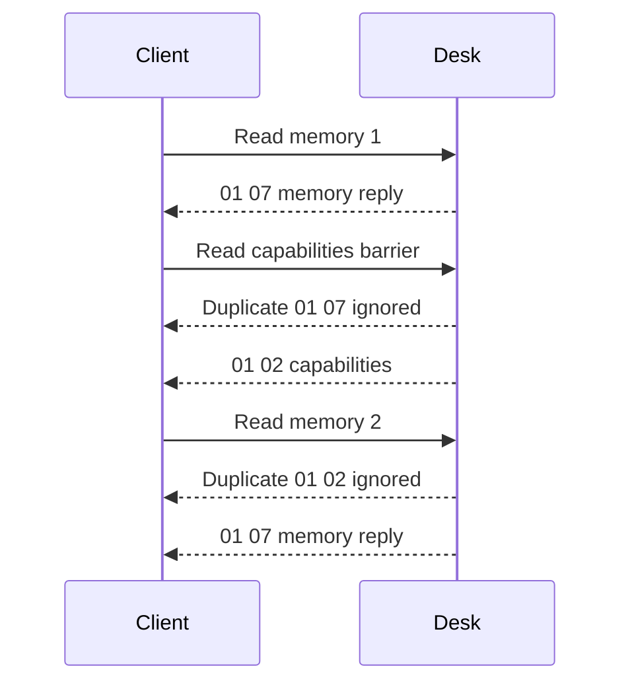

# DPG protocol reference

This reference describes the frames accepted by this integration and the evidence behind their interpretation. LINAK product manuals explain panel features, but no complete public GATT command specification was obtained. Community protocol definitions and one-panel observations do not establish compatibility with every firmware/OEM variant.

## GATT channels

Proprietary UUIDs below use suffix `-338a-1024-8a49-009c0215f78a`.

| UUID prefix or standard UUID | Role | Operation used |
| --- | --- | --- |
| `99fa0001` | Advertised desk service | Discovery |
| `99fa0002` | Control channel | Write without response for Stop/wake |
| `99fa0011` | Extended DPG commands and replies | Write with response plus notifications |
| `99fa0021` | Position/speed-word feedback | Read plus notifications |
| `99fa0031` | Relative target input | Write without response |
| `00002a00-0000-1000-8000-00805f9b34fb` | GAP Device Name | Optional read after authentication |

Reading `99fa0011` directly is not an extended-configuration query. Subscribe to notifications, send one allowlisted request and validate its reply. Motion characteristics must expose the required write operation; do not guess a write mode for missing properties.

## Position units and height reference

Height feedback contains exactly four bytes: little-endian unsigned `position_raw`, followed by the preserved raw speed word. Position uses 0.1 mm units, or 100 raw units per centimeter.

```text
height_cm = (position_raw + offset_raw) / 100
relative_target_raw = round(target_cm * 100 - offset_raw)
```

The offset is the panel's height reference. It is not a turbo-start position, firmware travel limit or a fixed IKEA datum. The decoder preserves the speed word without claiming verified direction/flags/units; nonzero speed is not an independently calibrated velocity sensor.

For a synthetic example, `position_raw = 1400` and `offset_raw = 6200` give `76.00 cm`. Correcting the reference changes converted heights, including displayed stored heights, without changing their raw mechanism positions.

## Extended reads

A read request is `7f <command> 00`. The DPG notification carries a response header and payload; byte counts below include the header. Only one query may be pending.

| Command | Meaning | Response header | Bytes | Decoded fields |
| --- | --- | --- | --- | --- |
| `80` | Capabilities | `01 02` | 4 | Capability flags and reference mask |
| `81` | Height offset | `01 03` | 5 | Validity byte and LE uint16 offset |
| `86` | Client identity/status | `01 11` | 19 | Status byte and 16 identifier bytes |
| `88` | Reminder configuration | `01 0b` | 13 | Flags, three sitting/standing pairs and raw counter |
| `89`–`8c` | Stored positions 1–4 | `01 07` | 9 when valid; 7 when empty | Validity, optional LE uint16 position and raw counter |

The capability flags expose a slot count in bits 0–2 and automatic-up, automatic-down, Bluetooth, display and light flags in successive bits. The implementation rejects unsupported slot counts above four. Capability flags are not setting values or proof that motion works on the current client.

Reminder durations are configuration values in minutes under the current interpretation, not elapsed sitting/standing counters. Unknown flags and counters remain raw. Do not label them as occupancy, lifetime cycles, uptime or calories.

## Correlate replies and reject ambiguity

Reply type and length must match the pending command. A successful GATT write alone does not establish that the query completed. A timeout, malformed reply or lost link invalidates the session instead of advancing to the next request.

All memory slots use response type `07` without a slot number. Duplicate signals can therefore be misassigned if consecutive slot requests have no intervening response type.



The client compares each barrier's capabilities with the initial snapshot. A change invalidates the refresh. An ordered stream of duplicates is filtered by response type; equal saved positions remain valid and are not deduplicated by value. Four memories add three capabilities barriers. This does not solve arbitrary out-of-order transport delivery or establish why BlueZ multiplied signals in the observed capture.

## Protected setting exchanges

Only client activation and height-reference correction have implemented protected setters. There is no generic arbitrary-write service.

| Operation | Allowlisted request | Preconditions | Required verification |
| --- | --- | --- | --- |
| Existing client activation | `7f 86 80 01 <same 16 identifier bytes>` | Valid `01 11` frame, recognized status, usable identifier; skip status `1` | Application acknowledgement, then status `1` and unchanged identifier |
| Height-reference correction | `7f 81 80 01 <offset-low> <offset-high>` | Confirmed stationary calibration proposal and valid unsigned reference | Application acknowledgement, then a full refresh with matching reference and position |

The observed exchanges treat status `0` as inactive and `1` as active. Their complete relationship to app Owner/Guest behavior and persistence is not established.

The client rejects empty/all-`ff` identifiers and unsupported status values. It neither generates nor replaces identity bytes, stores them in HA options nor publishes them in integration diagnostics.

A capabilities read barrier precedes each setting exchange. `01 00` is the successful application acknowledgement. A non-success two-byte status, including the observed `0b 00`, aborts without automatic retry. Its detailed vendor meaning remains unknown. GATT's write response and the DPG acknowledgement are separate checks.

Activation is permitted during confirmed preparation/calibration or an explicit foreground movement request. Ordinary reads, connection establishment and Stop do not activate clients. Persistent effects must not be inferred from one successful reconnect; see [hardware evidence](hardware-results.md).

## Motion frames

The controller sends these allowlisted frames on the dedicated motion characteristics.

| Channel | Bytes | Meaning in the current implementation |
| --- | --- | --- |
| Control `99fa0002` | `ff 00` | Stop |
| Control `99fa0002` | `fe 00` | Wake |
| Target `99fa0031` | LE uint16 relative target | Repeated target input during one explicit move |

The [movement reference](movement.md) owns ordering, timing, guards and cleanup. The upstream reference-input Stop candidate `01 80` is not sent by the current controller.

## Standard metadata and unsupported settings

GAP name bytes must decode as printable UTF-8. Missing/denied metadata retains the cached fallback; transport timeout or link loss still invalidates the connection. Names are separate from decoded `DeskState` and downloaded diagnostics.

The [settings reference](settings-reference.md) lists command candidates that are not implemented. Product documentation alone does not establish their wire encoding or authorization. The [source register](settings-reference.md#source-register) identifies pinned protocol implementations, while the [hardware evidence](hardware-results.md) states what has actually been observed.
