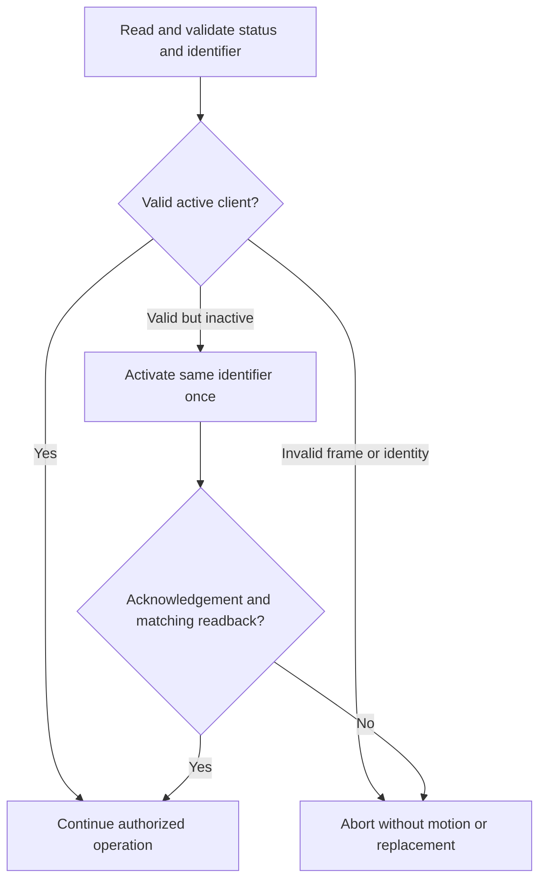

# Panel settings and height calibration

This reference distinguishes implemented panel settings, host-side HA configuration and unverified protocol candidates. Use the [control guide](controls.md) to configure a desk and the [protocol reference](protocol.md) for exact frames. Manufacturer features do not automatically imply a writable BLE interface on a particular firmware.

## Configuration layers

Panel settings, HA preferences and presentation have different owners and side effects.

| Layer | Examples | Where it changes | Effect |
| --- | --- | --- | --- |
| Panel configuration | Height reference, stored positions, reminder profiles, stored inch/metric preference | Only through a verified, scoped panel operation | Can affect the panel and another connected application |
| HA preferences | HA name and measured command bounds | Setup/Configure | Does not rename the radio or program firmware limits |
| Presentation | Whole-centimeter sensor/history values and slider steps | Entity boundary | Does not round raw position, calibration or stored-position targets |

Client activation is a separate application-readiness operation. It preserves the existing identifier and verifies status. It is not Bluetooth bonding, a radio-name setter or permission to overwrite ownership data.

## Feature inventory

Evidence labels mean manufacturer-documented product behavior, community protocol candidate, observed hardware behavior or simulated software validation. See the source register and [hardware evidence](hardware-results.md) for the underlying limits.

| Feature | Current HA surface | Implementation and evidence | Remaining requirement |
| --- | --- | --- | --- |
| Actual height | Ordinary centimeter sensor | Read from position plus panel offset; hardware reads observed | Compare physical height after any correction |
| Target height / Stop | Native number and button | Bounded controller and HA tests; limited movement feedback observed | Complete arrival, both directions and physical Stop accuracy |
| Drive to stored position | Buttons for supported slots | Fresh slot/reference read and common controller | Physical destination validation |
| Stored positions | Read-only ordinary sensors | Four read slots on the tested panel | Verified save/replace payload, slot identity and persistence before setters |
| Height reference | Read-only diagnostic sensor; protected calibration in Configure | Activation, acknowledgement and reference readback observed on one panel | Power-cycle persistence and other firmware |
| Existing client readiness | Foreground preparation | Preserved-identifier activation and verification | Status lifetime and behavior across firmware/restart conditions |
| HA device name | Name option and device registry | Implemented without BLE writes/reload | Radio/app-name writing is separate and unverified |
| Active reminder profile | Configuration select plus the existing ordinary sensor | Fresh masked assignment, ACK and independent readback; Off/Profile 3 hardware evidence at status 1 | Hardware acceptance of profiles 1/2, reconnect persistence and other variants |
| Sitting/standing durations | Three profile-pair sensors; six configuration inputs, five new inputs disabled by default; standard-time button for profile 1 sitting | Shared protected single-byte setter for all six fields; 50/55 in inactive profile 1 observed on one panel | Hardware acceptance of the other five fields, full input range, active-profile editing, countdown and persistence |
| Reminder light/presentation | Capability and raw reminder data only | Manufacturer feature and community bit candidates | Confirm exact state bits; a light capability is not on/off state |
| Stored panel unit preference | Configuration select: Metric/Inch | Masked bit `0x04`, ACK/readback and one reconnect observed | Exact metric sub-unit, immediate stationary OLED redraw, power-cycle persistence and other variants |
| Automatic up/down | Capability flags only | Manufacturer/community evidence | Distinguish panel automatic drive from host-driven target keepalives |
| Wake preference | No setter | Community settings-bit candidate, distinct from the implemented control wake command | Verify bit semantics and persistence |
| Firmware upper/lower limits | No remote setter or verified query | Manufacturer UI function | Discover supported protocol before claiming automatic limit import |
| Key lock / timeout | No setter | Manufacturer UI function | Verify remote semantics; do not assume physical lock blocks BLE motion |
| Reset operations | No reset button | Manufacturer UI function | Destructive scope and exact preservation/recovery behavior |
| Statistics/counters | Raw research fields | Bytes retained without meaning claims | Establish semantics before labeling occupancy, cycles, uptime or calories |
| Error/display-logo functions | No runtime interface | Product/catalogue candidates only | Demonstrate an exposed GATT contract |

Unsupported candidates do not create dummy controls. A verified capability model must handle absent/OEM-disabled functions and honest unavailable states.

## Model and variant matrix

The [device support reference](device-support.md) defines runtime family matching and tester eligibility. Product features are not a BLE command compatibility promise. Use the model-specific data sheets, then the reported capabilities, implementation support and hardware evidence as separate checks. A lower model is not automatically the same DPG1C with fewer enabled bits.

| Desk panel | Built-in Bluetooth | Height display | Documented favorites | Reminder hardware | Automatic drive / app control | Integration evidence |
| --- | --- | --- | --- | --- | --- | --- |
| DPG1K | Not listed in the cited manual's variant overview | Not listed | Not listed | Not listed | Not established here | No validation; an external adapter is a separate configuration |
| DPG1M | Yes | Described as the version without a display | Two in its data sheet | LED | Full/Limited variant dependent | No model-specific BLE validation |
| DPG1B | Yes | Not listed in its data sheet | Two | Light strip | Full/Limited variant dependent | No model-specific BLE validation |
| DPG1C | Yes | OLED | Up to four; OEM may disable slots 3/4 | Light strip | Full/Limited variant dependent | Reads and limited controls on one panel; exact ordering variant unknown |

Sources: [DPG1M data sheet, 2026-05, pp. 2–4](https://assets.linak.com/asset/590184044899/document_5o382q0u214ij3insa6qf9ci48?content-disposition=inline), [DPG1B data sheet, 2019-10, pp. 2–4](https://assets.linak.com/asset/590184044899/document_erjegku6lh1ffa089edj2lp653?content-disposition=inline), O2 for DPG1C and O1 for the variant overview and OEM restriction. The family page says up to four positions; this is not a four-slot guarantee for every model. The current manual's overview also lists a display for DPG1M, while the model-specific data sheet describes it as the no-display version. Preserve that source inconsistency and verify the actual SKU rather than inferring a capability from the overview.

For M, B and C, the cited ordering tables describe Limited as lacking wireless app control and automatic drive; Full permits those functions. Neither the advertised name nor successful read access identifies that ordering variant or establishes movement permission. Key-lock and other firmware options also need independent command evidence. DPI products need a separate profile; do not inherit the DPG matrix.

At runtime the integration reads only the reported 0–4 memory slots, with synthetic coverage for 0, 1, 2 and 4. It does not identify a model by slot count, assume a reminder-light flag proves a reminder query/setter, or add unsupported writes. The [capability contract](architecture.md#proposed-state-and-library-contracts) separates protocol flags, implemented operations and physical validation.

## Can HA configure more than the official app?

HA can already add automations, integration diagnostics and host-side command bounds around panel data. Those are host features, not additional firmware settings. No tested evidence currently establishes an exclusive panel setting that HA can change but the official app cannot.

| Candidate | Manufacturer/app evidence | Current HA behavior | Next proof needed |
| --- | --- | --- | --- |
| Favorite management | Product/app descriptions document favorites | Read and drive; no save/delete setter | Exact slot-safe write, acknowledgement, readback and persistence |
| Reminder intervals | App/product descriptions document configurable intervals | Read and edit both durations in each inactive profile with preserved-field readback | Hardware input bounds, other fields, countdown and persistence |
| Units and height reference | Panel documentation describes presentation and correction | Protected calibration and stored Inch/Metric preference; HA stays natively in cm | CM/MM-specific encoding, immediate OLED redraw and variant behavior |
| Automatic drive | Full variants document optional automatic drive | Read capability flags; no firmware toggle | Permission, semantics and independent control behavior |
| Lock, wake preference and display logo | Physical/product features or community candidates | No remote setters | Demonstrate a supported BLE command, not just a UI label or raw bit |
| OEM slot visibility and firmware limits | Manufacturer/configurator functions | No firmware-limit import or OEM override | Official or reproducible variant-specific protocol evidence; never infer from favorites |

The [official app description](https://www.linak.com/products/controls/desk-control-app) documents height adjustment, favorites, reminders and statistics. The [DPG1C data sheet](https://assets.linak.com/asset/590184044899/document_1660ji82jh2118i2b6r62ilc56?content-disposition=inline) also documents optional automatic drive through Desk Connect. Different app generations and OEM permissions prevent a blanket claim that an undocumented command is an extra feature. Follow the setter requirements below before adding any control.

## Unsupported command candidates

The pinned community catalogue contains additional opcodes. Their presence is not evidence that this panel accepts them or that the integration implements them.

| Command | Catalogue meaning | Boundary |
| --- | --- | --- |
| `87` | Reminder time | Candidate only; not interchangeable with the implemented `88` configuration read |
| `08` | Product information | No runtime support or response layout established here |
| `0a` | Setup | The source marks its setup entry nonworking; do not use it for recovery |
| `90` | Log | No verified diagnostic-event feed inferred from the name |
| `89`–`8c` setting forms | Stored-position writes | Reads are implemented; setters, slot verification and persistence remain unverified |

## Height calibration contract

Offset correction belongs to a dedicated measured-height workflow, not a dashboard number that can be changed accidentally. It adjusts the height reference without commanding the mechanism to move.

For a current stationary position, the proposed reference is:

```text
new_offset_raw = round(measured_height_cm * 100) - position_raw
reported_height_cm = (position_raw + offset_raw) / 100
```

| Check | Required behavior | Reason |
| --- | --- | --- |
| Measurement | Positive finite numeric desktop height; valid current position/reference | Reject invalid input and missing connection data |
| Encoding | Unsigned raw reference within the supported range | Do not invent a generic safe offset interval |
| Unchanged reference | Difference within half a 1 mm display step counts as unchanged | Avoid a setting write for display-rounding noise |
| Preview consistency | At most one 0.1 mm quantum from the old preview | Permit encoding jitter, not a moved desk |
| Immediate preflight | Two fresh position reads match exactly, speed zero and original offset unchanged | Tie the confirmed measurement to a stationary mechanism |
| Ownership | Reserve the client/query lock; reject competing movement/calibration | Do not interleave settings and targets |
| Confirmation | Present old/proposed heights and conversion effects before writing | A reference change also changes displayed saved heights |
| Client readiness | Check status, preserve identifier, acknowledge and verify activation if needed | Valid reads alone do not establish setting readiness |
| Offset write | Send the one allowlisted reference request once | No generic setting-write API or automatic replay |
| Readback | Required capabilities/reference/position reads with a different-type barrier before reference readback; exact position verification | Do not accept a setting echo as independent confirmation |
| Publication | Refresh height and bound validity together; invalidate optional groups after a reference change until reread | Keep every height in the same reference |

The complete calibration budget is 60 seconds plus bounded cleanup. It does not issue wake, target, saved-position writes or firmware-limit changes. The [protocol reference](protocol.md#protected-setting-exchanges) defines acknowledgement and payload validation.

If preflight detects changed position/reference, it rejects the proposal before a correction. If a write was sent but verification fails, the outcome is uncertain: read state again through a healthy session before proposing another correction. Do not retry or blindly restore an old offset. Measurement inputs are transient and never replayed at startup.

## Stored panel unit preference

The device page's Configuration section contains **Preferred panel units**, with **Metric** and **Inch** options. It changes the stored panel flag, not HA's entity presentation units, calibration, measured range or centimeter geometry. HA's own unit conversion remains independent, without silent synchronization. A physical MM mode exists on the tested panel, but fresh complete `88` replies and all known decoded state were identical in CM and MM. Metric therefore means only that the inch flag is clear. No separate CM/MM option or unique MM encoder is known.

The select uses the same protected transaction and reminder-group availability as profile selection below, without requiring travel bounds. It obtains fresh capabilities, stationary position and reminder bytes under the existing foreground/query reservation. An unchanged preference sends no setting write or identity query. A changed preference requires a freshly validated existing client at status 1; inactive status 0 is refused visibly without activation or identifier replacement. Busy/conflicting operations cannot queue.

Set or clear only bit `0x04`, preserving the seven other flags, including unknown `0x80` and profile bits, and all six duration bytes exactly. The request is the ten-byte `7f 88 80 <flags> <six durations>` on the DPG channel. Omit the read header and raw counter. Require exact two-byte `01 00`, a different-type capabilities barrier and an independent strict thirteen-byte `88` reply matching the complete requested body. Counter changes are allowed; its semantics remain unknown.

A verified stored preference is not proof of the text currently rendered on the OLED. Immediate stationary redraw is unconfirmed. This control sends no wake, activation, movement, calibration or forced reconnect to refresh the display. Never move the desk just to apply a unit change. Physical CM/MM choice and preservation of that panel-local choice across unrelated `88` writes remain unverified by the binary flag.

Negative/malformed ACKs, mismatching readback, timeout, cancellation or lost/ambiguous generation discard the session and report failure without optimistic state. A delivered write may already have changed the preference. After normal read recovery, check the stored preference and the actual panel separately before another explicit request. There is no retry, queue, replay or blind restoration. See the [unit evidence](hardware-results.md#stored-unit-preference-and-physical-display) for the distinction between stored readback and physical observations.

## Reminder profile selection

Use the configuration **Reminder profile** select to choose Off or Profile 1/2/3. The existing active-profile sensor stays registered with its original identity. This setting needs no measured travel range. A ready DPG connection and a valid reminder group are required; missing or invalid reminders make the select unavailable. There is no known capability bit proving writable reminders, so light/display flags are not used as setter permission. Fresh capabilities must still match the current validated device profile.

The existing client reserves the foreground operation before I/O and holds the query lock. It reads capabilities, stationary position and current reminders. Selecting the freshly read profile is a no-op without an identity check or setting write. Otherwise it validates a fresh `86` identity/status response and requires status 1. Status 0 is refused visibly without activation; unknown/invalid identities fail validation. Explicit control preparation in Configure is a separate operation, not a guarantee of firmware permissions.

The setter changes only the low two flags bits with `(flags & ~0x03) | profile`, copying all six interval bytes, including zero and unknown values. It sends one seven-byte body through `88`, omitting the raw counter. Exact application ACK `01 00`, a different-type capabilities barrier and independent `88` readback must confirm the requested profile, every unrelated flag and every interval. The counter may change and is not compared or written. Successful verification updates both the select and sensor from the returned settings.

Busy operations are refused without queuing. Timeout, cancellation, link/generation loss, malformed data, rejected ACK or mismatching readback discards the session. A possibly delivered write is never automatically retried or restored. Check the actual panel profile after normal read recovery before requesting another change. Setup, reconnect and polling only read settings; selecting a profile sends no wake, activation or movement.

Physical panel changes appear at the next ordinary reminder-group refresh, scheduled every 300 seconds. An observed delay of about five to six minutes is consistent with that policy and refresh scheduling, not immediate synchronization. A successful HA write performs its ACK/readback inside the transaction and publishes the verified result without waiting for that poll. No extra refresh or write is sent to detect physical changes.

Hardware evidence is limited to Profile 3 → Off → Profile 3 at observed client status 1 on one DPG1C. Profiles 1/2, status-0 write permissions, long-term stability and persistence are unverified. See the [evidence register](hardware-results.md#reminder-profile-setting) and [wire contract](protocol.md#protected-setting-exchanges). Tests of all four options use simulated BLE.

## Edit reminder durations

The device page's Configuration section contains sitting and standing number boxes for each of the three profiles. The five new inputs are disabled by default in the entity registry; enable only those needed. The existing **Profile 1 sitting time** retains its unique ID, name and user registry choices, including whether it is enabled. Profile selection remains the primary enabled interface. **Profile 1: use standard time** assigns only profile 1 sitting duration to 55 minutes, with the original button unique ID. They are configuration entities, not diagnostics, movement controls or fields in the integration's Configure wizard. The existing duration sensors and profile choices retain their identities and labels.

| Input rule | Meaning |
| --- | --- |
| Whole minutes, 1–60 inclusive | Product input policy in this integration, not a medical recommendation or measured firmware limit |
| No zero | Use the separate Off profile to disable reminders; zero-duration semantics are unverified |
| Existing value outside 1–60 | Keep and display the actual value, such as 90; do not clip, invalidate its read or automatically overwrite it |
| Explicit replacement | A user may replace an existing 90 with 50; an attempted edit to 90 is refused before I/O |
| Edited profile inactive | Refuse an actual sitting or standing duration change while that profile is selected; never switch profiles automatically |
| Already requested value | Fresh-state no-op, without a setter, identity query or activation |
| Standard-time button | Assign only 55 minutes; no full-profile restore, saved-value backup or factory reset |

LINAK's [DPG manual](https://assets.linak.com/asset/590184044899/document_hub5bdnb5l13pc4ebsja0cc702?content-disposition=inline), page 31, documents sitting-reminder presets 55, 50 and 45 minutes, default 55, and custom intervals through the app. It does not specify their minimum/maximum there. A minute duration is not a clock's minute component; the display does not establish a maximum of 59. The pinned community application uses independent 1–255 spinboxes for sitting and standing in every profile, not a measured firmware acceptance range. The existing 1–60 policy is retained for sitting and applied consistently to standing inputs; neither source establishes firmware limits. [HSE's work-routine guidance](https://www.hse.gov.uk/msd/dse/work-routine.htm) favors short, frequent breaks and gives 5–10 minutes every hour as an example; it does not prescribe universal medical timer bounds. The integration does not claim that 60 minutes is a safe sitting threshold.

The pinned [C1 reminder layout](https://github.com/anetczuk/linak_bt_desk/blob/7ac5fe1b69638976326842b27d76e52f0cc958fd/linak_dpg_bt/datatype/reminder_setting.py) decodes and serializes `<sit1> <stand1> <sit2> <stand2> <sit3> <stand3>` as independent bytes, omitting the counter. C2 exposes independent edits for each field. This supports the byte addressing used here, not hardware acceptance of all values or fields. The implementation preserves the entire fresh flags byte rather than reconstructing unknown bits from that community model.

Profile selection, interval editing and the standard-time button share one fresh read-modify-write transaction and foreground reservation. It validates the existing connection and reminder group, capabilities, stationary position and client status 1. The interval encoder changes exactly one byte, preserving all flags, the selected profile and the other five durations. The pair is not forced to sum to 60. The raw counter is omitted from the write and may change. Exact ACK, a capabilities barrier and independent full-body readback are required before the new value is published. Timeout, cancellation, lost generation or mismatching verification discards the session without retry or rollback. The same 1–60 whole-minute validation applies to HA services and the button.

The standard-time button uses the documented 55-minute sitting preset; it does not issue the separate physical reminder-reset procedure described on manual page 32. No restore runs on setup, polling, reconnect, failure or restart. The only hardware interval evidence is 55 → 50 → 55 in inactive profile 1 at status 1 on one DPG1C. All six field addresses and their protected transactions are covered in simulation. Actual countdown behavior, other values/fields, active-profile edits and persistence remain unverified. See the [interval evidence](hardware-results.md#single-reminder-interval) and the [owner procedure](controls.md#edit-one-reminder-duration).

## Client activation contract

Confirmed setup preparation, confirmed calibration and explicit movement can check the existing client. Ordinary discovery, pairing, polling, reconnect and idle Stop cannot activate it.



The implementation does not generate or replace the 16 identifier bytes. A successful reconnect in one experiment does not prove that active status persists in all future sessions. Each explicit control validates readiness rather than caching that assumption.

## Product and firmware constraints

Manufacturer sources constrain the investigation even when they do not expose command encodings:

| Documented constraint | Design consequence |
| --- | --- |
| DPG1C Full and Limited variants differ in app/automatic-drive support | Record exact variant; a generic model label or capability bit cannot prove writable support |
| OEM configuration can hide positions 3/4 from software 1.29 | Respect the reported/configured slot count |
| Display supports different units and height correction | Keep panel presentation separate from raw units and HA centimeters |
| Firmware/user upper/lower limits differ from host command bounds | Never present favorites or a fixed IKEA range as measured mechanical limits |
| Owner/Guest behavior and one connected Bluetooth client | Isolate diagnostic clients; keep application readiness separate from bonding |
| App statistics can accrue while connected without a person | Do not infer occupancy from connection, height or unknown counters |
| Reset can preserve configurator/OEM settings while clearing user data | Do not use factory reset as routine debugging or assume it removes every restriction |

Button symbols may disappear during PDF text extraction. Consult the visual manufacturer procedure before prescribing a physical-button sequence. Older Desk Control descriptions and newer Desk Connect naming are not automatically the same firmware/API contract.

## Requirements for another setting

A new setter needs a complete contract before its HA entity is added:

1. Pin the source and identify model/firmware/variant support.
2. Establish read/write formats, units, valid bounds and permissions.
3. Preserve unrelated bits and ownership data.
4. Define transport acknowledgement, application acknowledgement and independent readback.
5. Test reconnect/restart persistence, physical-panel edits and interaction with another app.
6. Define failure, uncertain-write recovery, cancellation and HA UI behavior.
7. Add synthetic fixtures, English/Polish labels/errors and scoped hardware evidence.

Connection/device reconfiguration remains planned; deleting/re-adding a desk is not the desired configuration model. Consult the [roadmap](roadmap.md) for delivery work, not this inventory's unsupported candidates.
## Source register

Use these exact source revisions when checking a protocol or product-behavior claim.

| ID | Source | Scope and version |
| --- | --- | --- |
| O1 | [LINAK DPG User Manual](https://assets.linak.com/asset/590184044899/document_hub5bdnb5l13pc4ebsja0cc702?content-disposition=inline) | 35 pages, 2026-04, LIT-13-02-060 B. Printed pages 18–19: calibration/units/limits; 25–27: memories/drive; 29–32: reminders/lock/reset. Product installation/operation reference, not a public BLE SDK. |
| O2 | [DPG1C data sheet](https://assets.linak.com/asset/590184044899/document_1660ji82jh2118i2b6r62ilc56?content-disposition=inline) | 7 pages. Page 3: features/options; page 5: variant ordering restrictions. |
| O3 | [LINAK DPG1C getting started](https://www.linak.com/work-res/start/dpg1c) | Manufacturer instructions/videos for favourites, reminders, pairing and operation. |
| O4 | [LINAK Desk Control App and FAQ](https://www.linak.co.uk/products/controls/desk-control-app/) | Manufacturer explanations of app settings, ownership, connection limits and statistics. App-version behavior must be checked separately. |
| O5 | [LINAK DPG family page](https://www.linak.com/products/controls/dpg-with-reminder) | Product family and current document-download entry point. |
| O6 | [DESKLINE product overview, Polish](https://cdn.linak.com/-/media/files/brochure-source/pl/lpl-deskline-product-overview.pdf) | Historically indexed official SDK overview. Direct retrieval failed in this review; do not treat it as a downloaded/current developer specification. |
| C1 | [linak_bt_desk command definitions](https://github.com/anetczuk/linak_bt_desk/blob/7ac5fe1b69638976326842b27d76e52f0cc958fd/linak_dpg_bt/command.py) | Pinned independent command catalogue/framing. |
| C2 | [LinakDeskApp settings UI](https://github.com/anetczuk/LinakDeskApp/blob/15d57d47327eeb72bacae6fc5a467b9e96ccaeea/src/linakdeskapp/gui/device_settings_widget.py) | Pinned independent settings candidates and write-then-read pattern. UI labels alone do not prove bit semantics. |
| C3 | [linak-controller GATT implementation](https://github.com/rhyst/linak-controller/blob/b46756231ed2ef5764c43bfc4c81f40b23cdc8ec/linak_controller/gatt.py) | Pinned independent transport/movement reference; see the [motion gate](movement.md). |

The downloaded O1 PDF has SHA-256 `7a58ee951c42d39817c2f623525b69d7cd834c19c84959d007623dea0afdcd9e`; O2 has `1b33c711169ff370057af4cc39759f202d9825e0cfba558efae54f400a1af53c`. Copies and a source manifest are retained in the local research workspace, not redistributed in this repository. Search snippets can still describe older 71/76-page editions; use the downloaded 35-page edition for O1 page references. Button symbols can disappear from PDF text extraction: consult the original visual instructions before giving an exact physical-button sequence.

## Additional implementation sources and SDK boundary

These references provide the initialization and calibration comparison used by the protected operations.

| Source | Scope |
| --- | --- |
| [Pinned idasen implementation](https://github.com/newAM/idasen/blob/db7cdd246d4ccb6e09ee3dfe83d192d9a5623b5b/idasen/__init__.py) | DPG1C initialization, target/Stop implementation and comparison baseline |
| [DPG1C initialization discussion](https://github.com/rhyst/linak-controller/issues/32#issuecomment-1784055470) | Independent reports of readable height with failed movement and initialization candidates |
| [Pinned height setter](https://github.com/anetczuk/linak_bt_desk/blob/7ac5fe1b69638976326842b27d76e52f0cc958fd/linak_dpg_bt/linak_device.py#L507) | Measured height minus relative position, encoded as the panel reference |
| [Pinned position encoder](https://github.com/anetczuk/linak_bt_desk/blob/7ac5fe1b69638976326842b27d76e52f0cc958fd/linak_dpg_bt/datatype/desk_position.py#L62) | LE uint16 position representation |

No complete public DESKLINE GATT specification or downloadable developer SDK was obtained. An indexed SDK brochure does not establish current access, supported firmware, licensing or redistribution rights. Open manufacturer questions include exact variant support, official pairing/client initialization, setting permissions/persistence, firmware limits, lock behavior and Stop behavior under connection loss. No manufacturer inquiry has been sent.
