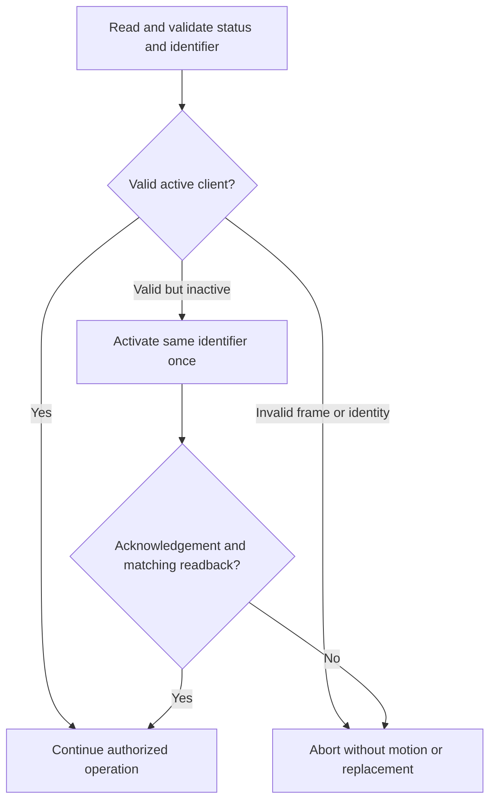

# Panel settings and height calibration

This reference distinguishes implemented panel settings, host-side HA configuration and unverified protocol candidates. Use the [control guide](controls.md) to configure a desk and the [protocol reference](protocol.md) for exact frames. Manufacturer features do not automatically imply a writable BLE interface on a particular firmware.

## Configuration layers

| Layer | Examples | Where it changes | Effect |
| --- | --- | --- | --- |
| Panel configuration | Height reference, stored positions, reminder profiles | Only through a verified, scoped panel operation | Can affect the panel and another connected application |
| HA preferences | HA name and measured command bounds | Setup/Configure | Does not rename the radio or program firmware limits |
| Presentation | Whole-centimeter sensor/history values and slider steps | Entity boundary | Does not round raw position, calibration or stored-position targets |

Client activation is a separate application-readiness operation. It preserves the existing identifier and verifies status. It is not Bluetooth bonding, a radio-name setter or permission to overwrite ownership data.

## Feature inventory

Evidence labels mean manufacturer-documented product behavior, community protocol candidate, observed hardware behavior or simulated software validation. See the source register and [hardware evidence](hardware-results.md) for the underlying limits.

| Feature | Current HA surface | Implementation and evidence | Remaining requirement |
| --- | --- | --- | --- |
| Actual height | Ordinary centimeter sensor | Read from position plus panel offset; hardware reads observed | Compare physical height after any correction |
| Target height / Stop | Native number and button | Bounded controller and HA tests; limited movement feedback observed | Complete arrival, both directions and physical Stop accuracy |
| Drive to stored position | Buttons for supported slots | Fresh slot/reference read and common controller | Physical destination validation |
| Stored positions | Read-only ordinary sensors | Four read slots on the tested panel | Verified save/replace payload, slot identity and persistence before setters |
| Height reference | Read-only diagnostic sensor; protected calibration in Configure | Activation, acknowledgement and reference readback observed on one panel | Power-cycle persistence and other firmware |
| Existing client readiness | Foreground preparation | Preserved-identifier activation and verification | Status lifetime and behavior across firmware/restart conditions |
| HA device name | Name option and device registry | Implemented without BLE writes/reload | Radio/app-name writing is separate and unverified |
| Active reminder profile | Read-only ordinary sensor | Profile decoded from reminder flags | Verify writable selection and off-state encoding |
| Sitting/standing durations | Three read-only profile pairs | Read configuration durations in minutes | Verify write bounds, encoding and persistence |
| Reminder light/presentation | Capability and raw reminder data only | Manufacturer feature and community bit candidates | Confirm exact state bits; a light capability is not on/off state |
| Display units | No setter | Manufacturer/community evidence | Verify encoding while preserving the HA centimeter contract |
| Automatic up/down | Capability flags only | Manufacturer/community evidence | Distinguish panel automatic drive from host-driven target keepalives |
| Firmware upper/lower limits | No remote setter or verified query | Manufacturer UI function | Discover supported protocol before claiming automatic limit import |
| Key lock / timeout | No setter | Manufacturer UI function | Verify remote semantics; do not assume physical lock blocks BLE motion |
| Reset operations | No reset button | Manufacturer UI function | Destructive scope and exact preservation/recovery behavior |
| Statistics/counters | Raw research fields | Bytes retained without meaning claims | Establish semantics before labeling occupancy, cycles, uptime or calories |
| Error/display-logo functions | No runtime interface | Product/catalogue candidates only | Demonstrate an exposed GATT contract |

Unsupported candidates do not create dummy controls. A verified capability model must handle absent/OEM-disabled functions and honest unavailable states.

## Height calibration contract

Offset correction belongs to a dedicated measured-height workflow, not a dashboard number that can be changed accidentally. It adjusts the height reference without commanding the mechanism to move.

For a current stationary position, the proposed reference is:

```text
new_offset_raw = round(measured_height_cm * 100) - position_raw
reported_height_cm = (position_raw + offset_raw) / 100
```

| Check | Required behavior | Reason |
| --- | --- | --- |
| Measurement | Positive finite numeric desktop height; valid current position/reference | Reject invalid input and missing connection data |
| Encoding | Unsigned raw reference within the supported range | Do not invent a generic safe offset interval |
| Unchanged reference | Difference within half a 1 mm display step counts as unchanged | Avoid a setting write for display-rounding noise |
| Preview consistency | At most one 0.1 mm quantum from the old preview | Permit encoding jitter, not a moved desk |
| Immediate preflight | Two fresh position reads match exactly, speed zero and original offset unchanged | Tie the confirmed measurement to a stationary mechanism |
| Ownership | Reserve the client/query lock; reject competing movement/calibration | Do not interleave settings and targets |
| Confirmation | Present old/proposed heights and conversion effects before writing | A reference change also changes displayed saved heights |
| Client readiness | Check status, preserve identifier, acknowledge and verify activation if needed | Valid reads alone do not establish setting readiness |
| Offset write | Send the one allowlisted reference request once | No generic setting-write API or automatic replay |
| Readback | Full refresh with a different-type barrier before reference readback; exact position verification | Do not accept a setting echo as independent confirmation |
| Publication | Refresh height, stored-height conversions and bound validity together | Keep every height in the same reference |

The complete calibration budget is 60 seconds plus bounded cleanup. It does not issue wake, target, saved-position writes or firmware-limit changes. The [protocol reference](protocol.md#protected-setting-exchanges) defines acknowledgement and payload validation.

If preflight detects changed position/reference, it rejects the proposal before a correction. If a write was sent but verification fails, the outcome is uncertain: read state again through a healthy session before proposing another correction. Do not retry or blindly restore an old offset. Measurement inputs are transient and never replayed at startup.

## Client activation contract

Confirmed setup preparation, confirmed calibration and explicit movement can check the existing client. Ordinary discovery, pairing, polling, reconnect and idle Stop cannot activate it.



The implementation does not generate or replace the 16 identifier bytes. A successful reconnect in one experiment does not prove that active status persists in all future sessions. Each explicit control validates readiness rather than caching that assumption.

## Product and firmware constraints

Manufacturer sources constrain the investigation even when they do not expose command encodings:

| Documented constraint | Design consequence |
| --- | --- |
| DPG1C Full and Limited variants differ in app/automatic-drive support | Record exact variant; a generic model label or capability bit cannot prove writable support |
| OEM configuration can hide positions 3/4 from software 1.29 | Respect the reported/configured slot count |
| Display supports different units and height correction | Keep panel presentation separate from raw units and HA centimeters |
| Firmware/user upper/lower limits differ from host command bounds | Never present favorites or a fixed IKEA range as measured mechanical limits |
| Owner/Guest behavior and one connected Bluetooth client | Isolate diagnostic clients; keep application readiness separate from bonding |
| App statistics can accrue while connected without a person | Do not infer occupancy from connection, height or unknown counters |
| Reset can preserve configurator/OEM settings while clearing user data | Do not use factory reset as routine debugging or assume it removes every restriction |

Button symbols may disappear during PDF text extraction. Consult the visual manufacturer procedure before prescribing a physical-button sequence. Older Desk Control descriptions and newer Desk Connect naming are not automatically the same firmware/API contract.

## Requirements for another setting

A new setter needs a complete contract before its HA entity is added:

1. Pin the source and identify model/firmware/variant support.
2. Establish read/write formats, units, valid bounds and permissions.
3. Preserve unrelated bits and ownership data.
4. Define transport acknowledgement, application acknowledgement and independent readback.
5. Test reconnect/restart persistence, physical-panel edits and interaction with another app.
6. Define failure, uncertain-write recovery, cancellation and HA UI behavior.
7. Add synthetic fixtures, English/Polish labels/errors and scoped hardware evidence.

Connection/device reconfiguration remains planned; deleting/re-adding a desk is not the desired configuration model. Consult the [roadmap](roadmap.md) for delivery work, not this inventory's unsupported candidates.
## Source register

| ID | Source | Scope and version |
| --- | --- | --- |
| O1 | [LINAK DPG User Manual](https://assets.linak.com/asset/590184044899/document_hub5bdnb5l13pc4ebsja0cc702?content-disposition=inline) | 35 pages, 2026-04, LIT-13-02-060 B. Printed pages 18–19: calibration/units/limits; 25–27: memories/drive; 29–32: reminders/lock/reset. Product installation/operation reference, not a public BLE SDK. |
| O2 | [DPG1C data sheet](https://assets.linak.com/asset/590184044899/document_1660ji82jh2118i2b6r62ilc56?content-disposition=inline) | 7 pages. Page 3: features/options; page 5: variant ordering restrictions. |
| O3 | [LINAK DPG1C getting started](https://www.linak.com/work-res/start/dpg1c) | Manufacturer instructions/videos for favourites, reminders, pairing and operation. |
| O4 | [LINAK Desk Control App and FAQ](https://www.linak.co.uk/products/controls/desk-control-app/) | Manufacturer explanations of app settings, ownership, connection limits and statistics. App-version behavior must be checked separately. |
| O5 | [LINAK DPG family page](https://www.linak.com/products/controls/dpg-with-reminder) | Product family and current document-download entry point. |
| O6 | [DESKLINE product overview, Polish](https://cdn.linak.com/-/media/files/brochure-source/pl/lpl-deskline-product-overview.pdf) | Historically indexed official SDK overview. Direct retrieval failed in this review; do not treat it as a downloaded/current developer specification. |
| C1 | [linak_bt_desk command definitions](https://github.com/anetczuk/linak_bt_desk/blob/7ac5fe1b69638976326842b27d76e52f0cc958fd/linak_dpg_bt/command.py) | Pinned independent command catalogue/framing. |
| C2 | [LinakDeskApp settings UI](https://github.com/anetczuk/LinakDeskApp/blob/15d57d47327eeb72bacae6fc5a467b9e96ccaeea/src/linakdeskapp/gui/device_settings_widget.py) | Pinned independent settings candidates and write-then-read pattern. UI labels alone do not prove bit semantics. |
| C3 | [linak-controller GATT implementation](https://github.com/rhyst/linak-controller/blob/b46756231ed2ef5764c43bfc4c81f40b23cdc8ec/linak_controller/gatt.py) | Pinned independent transport/movement reference; see the [motion gate](movement.md). |

The downloaded O1 PDF has SHA-256 `7a58ee951c42d39817c2f623525b69d7cd834c19c84959d007623dea0afdcd9e`; O2 has `1b33c711169ff370057af4cc39759f202d9825e0cfba558efae54f400a1af53c`. Copies and a source manifest are retained in the local research workspace, not redistributed in this repository. Search snippets can still describe older 71/76-page editions; use the downloaded 35-page edition for O1 page references. Button symbols can disappear from PDF text extraction: consult the original visual instructions before giving an exact physical-button sequence.

## Additional implementation sources and SDK boundary

| Source | Scope |
| --- | --- |
| [Pinned idasen implementation](https://github.com/newAM/idasen/blob/db7cdd246d4ccb6e09ee3dfe83d192d9a5623b5b/idasen/__init__.py) | DPG1C initialization, target/Stop implementation and comparison baseline |
| [DPG1C initialization discussion](https://github.com/rhyst/linak-controller/issues/32#issuecomment-1784055470) | Independent reports of readable height with failed movement and initialization candidates |
| [Pinned height setter](https://github.com/anetczuk/linak_bt_desk/blob/7ac5fe1b69638976326842b27d76e52f0cc958fd/linak_dpg_bt/linak_device.py#L507) | Measured height minus relative position, encoded as the panel reference |
| [Pinned position encoder](https://github.com/anetczuk/linak_bt_desk/blob/7ac5fe1b69638976326842b27d76e52f0cc958fd/linak_dpg_bt/datatype/desk_position.py#L62) | LE uint16 position representation |

No complete public DESKLINE GATT specification or downloadable developer SDK was obtained. An indexed SDK brochure does not establish current access, supported firmware, licensing or redistribution rights. Open manufacturer questions include exact variant support, official pairing/client initialization, setting permissions/persistence, firmware limits, lock behavior and Stop behavior under connection loss. No manufacturer inquiry has been sent.
